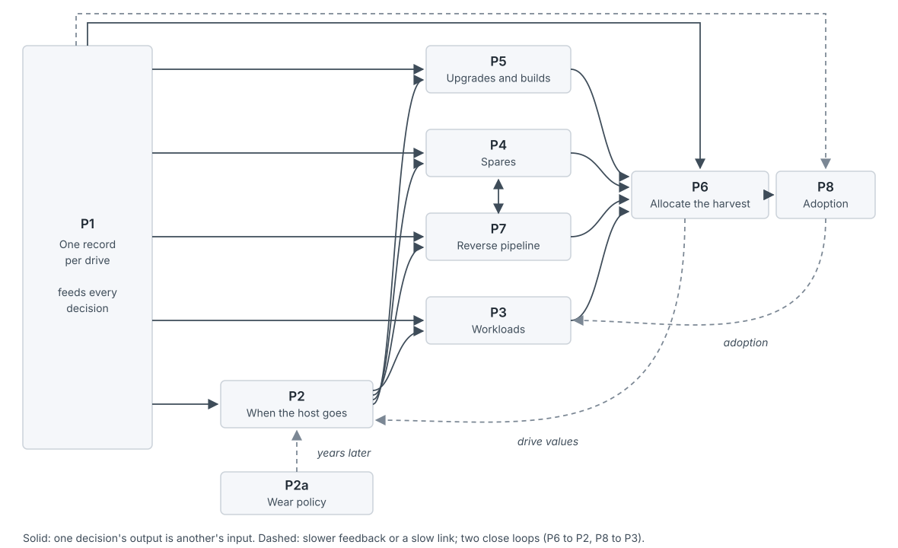

This page is the strategy for [Case 3](case-kuantillion-cloud.md). It shows how a practitioner would tackle the case with the practice's body of knowledge. You'll see how to frame the problem, how to break it down and what order to work it in.

Two companion pages sit beside it. The [full case](case-kuantillion-cloud-full.md) sets out the problem in detail and prescribes nothing. The [execution plan](case-kuantillion-cloud-plan.md) turns this strategy into owners, dates, gates and tables. You don't need either to follow this page. Each section carries enough context to stand on its own.

Section numbers refer to the seed paper, *The Coefficient Is an Agreement*. Mechanism numbers refer to its thirteen mechanisms (Section 9.2), explained on [the operating mechanisms](concept-operating-mechanisms.md). The paper is "a practitioner synthesis, not a model, and untested" (Abstract), and so is everything here.

Read the labels this way. A quote with a Section is the paper's own text. *Applied here* or *our reading* marks the paper's rule used on something it wasn't written for. [argued] marks a rule this page adds. [unmeasured] marks a number nobody has published. Every invented number is labeled illustrative.

One scope note. Flash stranded inside running machines is a second prize, possibly the larger one. It needs no sanitization, custody or qualification, only scheduling and pooling. So it runs as its own track, beside the harvest, and is sized on its own.

## The problem in brief

Kuantillion Cloud is a fictional hyperscale operator. It runs one of the largest computing fleets in the world and plans about $200 billion of capital spending in 2026. Even so, it reports more demand than it can supply ([the full case, section 1](case-kuantillion-cloud-full.md#1-executive-summary)).

**The shock.** New enterprise flash now costs three to four times what it did a year earlier. Next year's supply from the flash makers is largely pledged to their biggest buyers already. Any flash Kuantillion Cloud didn't contract for in advance is hard to get at any price.

**The old flash.** Kuantillion Cloud retires machines every year and takes them apart. In 2024 it wiped and then reused or resold over 3 million drives. Its reports call them hard drives, so how many were solid-state drives (SSDs) is unknown. Older flash also sits idle inside machines that are still running. One peer cloud measured 54% of its server SSD capacity stranded that way ([section 4.1](case-kuantillion-cloud-full.md#4-1-four-populations)).

**Where a drive can go.** When a host retires, it can be kept, redeployed whole to lighter work, or taken apart. A harvested drive then has four sinks ([section 5](case-kuantillion-cloud-full.md#5-demand-four-places-a-legacy-drive-can-go)):

- a workload that tolerates older flash;
- the pool of repair spares for old platforms;
- an upgrade or a new build;
- exit, through resale, recycling or the shredder.

**Why that is hard.** A drive isn't one quantity. It has five dimensions: capacity, performance, remaining endurance, fit and condition history. Each sink prices a different one. Spares price fit, workloads price capacity and latency, and resale prices provable condition. No shared unit or internal price exists for any of them.

**The technical gates.** Eleven technical gates stand between a retired host and a second life ([section 6](case-kuantillion-cloud-full.md#6-supply-the-gates)). They are physical fit, protocol, qualification, firmware, observability, condition, change windows, systems of record, systems complexity, jurisdiction and sanitization. A drive whose data can't be shown to be gone is destroyed. This page calls them technical gates, to keep them apart from the program's own decision gates.

**The risk.** Nobody has published how reused drives behave in a second life. First-life studies disagree on late-life hazard, and two large ones saw no rise at end of life. Firmware, model and error history matter more than age. Failures cluster: in one fleet, a second replacement in the same RAID group was 180 times likelier within a week. Two firmware bugs killed drives at fixed power-on ages, about 3.7 and 4.6 years. One operator's figure, legacy drives at 22% of drives but 77% of failures, covers one quarter and is confounded with model and warranty ([section 6.1](case-kuantillion-cloud-full.md#6-1-what-is-actually-known-about-second-lives)).

**A leak upstream, where triage is weak.** At one large cloud, 34.4% of SSD-related tickets weren't the drive: human error and cables. Its repair sequence fixed those with cheaper steps first, and only 31.2% of tickets ended in a drive swap. A site that pulls a drive on every ticket would use up to about 1.5 times true failures. Kuantillion Cloud's own healthy share of pulled drives is unknown ([section 4.4](case-kuantillion-cloud-full.md#4-4-the-leak-upstream-of-the-cage-tickets-that-werent-the-drive)).

**The money.** A used drive's replacement value runs about $190–640 per terabyte across the case's range. Its book value is near zero past a six-year accounting life. The central fork is what kind of value a reused drive creates ([section 7.1](case-kuantillion-cloud-full.md#7-1-the-anchor-question-what-kind-of-value-is-this)). If flash contracts can be rescheduled, it avoids a purchase. If they are firm, it adds capacity to a sold-out fleet. Those are different numbers, with different beneficiaries.

**The size.** The SSD harvest could be under 1% or near 30% of a year's new flash, central 3–9% (illustrative). That range sets the program's scope. Whether the program pays at all is a dollar question: its margin over exit against its fixed cost.

**The organization.** Allocation and value recovery sit in different groups. The technicians who pull drives are measured on ticket speed, which pushes drives toward the shredder. Three of the case's decisions have no public owner at all ([section 11](case-kuantillion-cloud-full.md#11-problem-decomposition)). The groups are mapped in [section 10.2](case-kuantillion-cloud-full.md#10-2-the-team-map-and-the-seams-between-them).

**Two futures.** On Path A, flash stays tight through 2028. On Path B, it eases from late 2027 and high-capacity drives get cheap first ([section 8](case-kuantillion-cloud-full.md#8-two-futures-and-the-signposts-between-them)). A good answer has to work under both.

**The decisions.** The case breaks the problem into eight decisions and two sub-decisions ([section 11](case-kuantillion-cloud-full.md#11-problem-decomposition)):

| | Decision |
|---|---|
| P1 | One record per drive |
| P2 | When the host goes: keep, redeploy whole or harvest |
| P2a | The wear policy that shapes tomorrow's harvest |
| P3 | Match legacy flash to workloads |
| P4 | Size and source legacy spares |
| P5 | Use legacy flash in upgrades and builds |
| P6 | Allocate the harvest across sinks |
| P6, commitment | How much of a harvest to count on before it arrives |
| P7 | Run the reverse pipeline at the needed rate |
| P8 | Make reuse something teams choose |

## How a practitioner tackles it: the strategy

### The stance

Kuantillion Cloud's problem is the paper's problem run backwards. The paper follows capacity from approval to live service. Here capacity comes back out of live service. You must price it, book it and hand it out again.

That inversion is the key to using the body of knowledge here. Almost every tool in the practice still works, pointed the other way. A retirement becomes a delivery. The reverse pipeline becomes a turn-up layer. A harvest becomes a supply declaration that firms up in stages. Where a tool doesn't turn around, you've found a limit of the practice.

You also start from the planner's real position. The planner sits in the middle, "usually owning no capacity and no budget" (Section 10). So your strategy is a set of agreements, not a set of orders. A broker still needs a principal, though. A sponsor who appoints the lead, chairs the forum and funds the pipeline until the landing rule credits it comes first [argued]. [People: brokering the handshake](people.md) explains where that standing comes from.

The practice's [principles](principles.md) set the stance. Each one points at a specific move in this case.

- **A coefficient is an agreement.** The wear price, spares per failure and usable terabytes per retiring drive all look like physics. Each moves someone's plan or bill, and nobody owns them.
- **Approval is not allocation.** A drive approved for a sink can still fail a gate, or be promised twice. The gap needs a ledger.
- **Commit only what the lead time forces.** Last-time buys and decommission dates commit long before the need is known. Map them.
- **Every number has an owner.** Three decisions have none. Name them.
- **Name the gap.** A harvest that won't arrive on time is a named gap, not a surprise.
- **Agree the rules before you need them.** The shortage rule and the landing rule must exist before drives are scarce or savings appear.
- **Say what's unmeasured.** Second-life failure rates, gate yields and the capacity value of a terabyte are unpublished. Build the strategy so the first pilot measures them.

### The moves that matter most, and why they come first

Six moves carry most of the weight. Each removes a large uncertainty for little cost, and the first five set up the next.

1. **Find out what exists.** The public record is silent on any program. Silence could mean a program run quietly, one tried and dropped, or none. Designing before you know wastes the most effort of anything here.
2. **Size the problem in dollars and name its value anchor.** Our reading of Section 13 is that a program below materiality costs more than it returns. The test is the annual margin over exit against the program's fixed cost; the ratio of harvest to new flash sets scope. The flash contracts settle which kind of value a drive creates. Nothing else can be priced until both are known.
3. **Book each retirement in both directions.** The register of mechanism 11 already holds "decommissions as dated supply steps" (Section 9.2). Applied here, the same retirement is also a delivery of drives, booked the same way. That one move turns a byproduct into supply you can plan against.
4. **Give every drive one record and every gap an owner.** Without a record, a drive can be promised twice or lost from custody. Without a forum, the loudest sink wins. And "Shortage rules come before the shortage" (Section 9.3), so the forum must exist early to agree them.
5. **Prove fulfillment with spares, then extend.** Spares are the harvest's most predictable claim and its value floor. The paper's order of change is "prove fulfillment first" (Section 10.4); we apply it to reused drives. Workloads, the riskier sink, come after trust exists.
6. **Reach the stranded stock in parallel.** Idle flash in running machines may be worth two to six times the top harvest row, at 11–35 EB once after a haircut. Reclaiming it is a scheduler and pooling problem, so storage systems and the schedulers can start in week two. A reclaim pilot, read out by day 90, is its go or no-go [argued].

The first five come first because they share one property. Each one is cheap, fast and decides whether the expensive work is worth doing. Everything else in this page depends on their answers. The [execution plan](case-kuantillion-cloud-plan.md) gives them owners and dates.

**Where the practice runs out.** The page names eight gaps, and six matter most. They are byproduct supply, condition as a dimension of supply, quality that fails after delivery, exit as a sink, the cost of a shape, and wear across two lives. [Where the theory runs out](#where-the-theory-runs-out) maps each to the literature that studied it.

### The theory map

Each concept below does work in this case. The table tells you where to read the theory, and where on this page it is applied.

| Concept | Guide page | Seed | Glossary term | Where it does work here |
|---|---|---|---|---|
| The coefficient | [The coefficient](concept-the-coefficient.md) | Sections 5.1–5.3 | [coefficient](/glossary/#term-coefficient) | The wear price, spares per failure, usable terabytes per retiring drive; [P2a](#p2a-the-wear-sub-decision), [P4](#p4-size-and-source-legacy-spares) |
| Three prices | [Three prices](concept-three-prices.md) | Section 4 | — | The value anchor, keeping hosts, ranking sinks; [P2](#p2-when-the-host-goes-keep-redeploy-whole-or-harvest), [P6](#p6-allocate-the-harvest-across-sinks) |
| Declarations | [Demand and declarations](concept-demand-and-declarations.md) | Sections 5.4, 6.7 | [declaration](/glossary/#term-declaration), [stage](/glossary/#term-stage) | Harvest as a staged supply declaration; build programs; [P5](#p5-use-legacy-flash-in-upgrades-and-builds), [P6 commitment](#p6-the-commitment-question) |
| Approval and allocation | [Approval and allocation](concept-approval-and-allocation.md) | Sections 6, 6.1, 6.4 | [fulfillment](/glossary/#term-fulfillment), [pegging](/glossary/#term-pegging) | Five dimensions, the drive ledger, bridges; [P1](#p1-one-record-per-drive), [P3](#p3-match-legacy-flash-to-workloads), [P6](#p6-allocate-the-harvest-across-sinks) |
| Buffers and reserves | [Buffers and reserves](concept-buffers-and-reserves.md) | Sections 6.3, 6.6, 10.2 | [shortage-to-idle ratio](/glossary/#term-shortage-to-idle-ratio), [stocked pool](/glossary/#term-stocked-pool) | The spares pool, misdiagnosis, cohort risk; [P4](#p4-size-and-source-legacy-spares), [P3](#p3-match-legacy-flash-to-workloads) |
| Supply layers and lead times | [Supply layers and lead times](concept-supply-layers-and-lead-times.md) | Sections 6.2, 6.4, 6.7 | [supply layer](/glossary/#term-supply-layer), [turn-up](/glossary/#term-turn-up) | The reverse pipeline as turn-up; contracts and push-out; [P7](#p7-run-the-reverse-pipeline-at-the-needed-rate), [P5](#p5-use-legacy-flash-in-upgrades-and-builds) |
| Commit points | [Commit points](concept-commit-points.md) | Sections 6.5, 8, Appendix A | [commit point](/glossary/#term-commit-point), [the three choices](/glossary/#term-the-three-choices) | Last-time buys; decommission dates; the booking rule; [P4](#p4-size-and-source-legacy-spares), [P6 commitment](#p6-the-commitment-question) |
| The measuring loop | [The measuring loop](concept-measuring-loop.md) | Sections 5.2, 5.4 | — | Endurance used by cohort; the healthy share of pulls; [P2a](#p2a-the-wear-sub-decision), [P4](#p4-size-and-source-legacy-spares) |
| The operating mechanisms | [The operating mechanisms](concept-operating-mechanisms.md) | Sections 9.1–9.3 | [forum](/glossary/#term-forum), [unallocated line](/glossary/#term-unallocated-line) | The audit of thirteen; the forum; the stranded line; [P6](#p6-allocate-the-harvest-across-sinks), [P8](#p8-make-reuse-something-teams-choose) |
| People and seams | [People](people.md) | Sections 10, 10.1–10.4, 14 | [forum](/glossary/#term-forum) | Owners, seams, incentives, legitimacy; [P1](#p1-one-record-per-drive), [P8](#p8-make-reuse-something-teams-choose) |
| Limits | [Limits](limits.md), [Settings](settings.md) | Sections 12, 13 | — | Materiality, no reference class, the stop rule; sequencing |

## The problem through the practice's lenses

Each lens below is one concept from the guide. For each, you get the idea in brief, how it reframes the problem, what it reveals that the case alone doesn't, and which decisions it bears on. Read the one you need; each stands alone.

### The coefficient

**The idea.** A caller's bill on a shared service is roughly volume × coefficient × rate. The [coefficient](/glossary/#term-coefficient) is resource used per unit of volume. Read forward, it forecasts load. Read backward, it is a price. So the paper's first claim is that a coefficient is an agreement. It "holds only while someone owns it, versions it and restates it when hardware or measurement changes" (Abstract). [The coefficient](concept-the-coefficient.md) sets out the full idea, with the register that holds it.

**How it reframes the problem.** The case's numbers look like physics or accounting. Our reading is that each is an agreement nobody signed. Six exhibits show it.

- **The wear price.** Kuantillion Cloud prices flash wear per byte written, at a rate set by each model's rated endurance. That is a coefficient and a rate in one number. "If α moves, the fleet plan and the bill move together" (Section 5.2). It is set on rated endurance, not what remains. When a drive starts a second life, the basis changes. Our reading: that is a re-grain, "a change in how the metric is measured" (Section 5.3). Nobody versions it or owns it in public. Mechanism 3 is the register it lacks.
- **Spares per failure.** Spares need is read from repair tickets. At one peer, about a third of SSD-related tickets weren't the drive, but triage caught them before any swap. Only at a site that pulls on every ticket would pulls run up to about 1.5 times true failures. Read for spares, when diagnosis improves, the ruler changes: "Price series are adjusted for such events, not forecast through them" (Section 5.3).
- **Usable terabytes per retiring drive.** The coefficient that turns a retirement into supply is SSD share × capacity × yield. No operator publishes the yield [unmeasured]. The paper says every netting term "is a forecast too", and each needs "a date and an owner" (Section 8.2). A yield that disappoints "looks like a supply failure", as the paper says of a slipped decommission (Section 6).
- **The drive's value.** The case carries a replacement value of about $190–640 per TB. Book value is near zero past the six-year life, and no transfer price exists. "Useful life alone is a large lever that moves both ways" (Section 4). Here a drive past its accounting life is worth far more than its book value.
- **The planning unit.** Quota and terabytes carry capacity and drop the other four dimensions. "The unit's weights decide which asks look cheap" (Section 6.1). The scarce dimension differs by sink: fit for spares, fit and qualification for upgrades, provable condition for resale. Read for drives, each sink's shadow price falls on a different dimension.
- **The generation break.** An older write-intensive drive can out-endure a new high-capacity drive per terabyte. Power per terabyte differs about 10–60 times across the same break. Averaging across it is "Forecasting through breaks" (mechanism 6). The paper's answer is to restate "per service, measured" (Section 5.3). Applied here, the unit is the cohort.

**What it reveals.** Each of these numbers moves someone's plan or bill, and none has an owner, a version or an effective date. The case reads them as unknowns to be measured. The lens reads them as agreements to be made. That changes the first job from research to governance. The paper asks you to version both rate and coefficient (Section 5.2), and mechanism 3 is where they live.

It also reveals why the generation break matters so much. A fleet-wide average of failure rate, endurance or power per terabyte blends cohorts that behave differently. Planning on that average forecasts through a break. The cohort, not the fleet or the generation, becomes the grain of every coefficient here.

**Decisions it bears on.** P2a, the wear price, is a coefficient read backward. P4 sizes spares on a per-failure coefficient that misdiagnosis distorts. P6 needs an internal rate for drives, which is a rate. P1 holds the fields every coefficient is computed from.

### Three prices

**The idea.** "What does capacity cost?" is three questions. Who pays uses the average loaded rate. Should we build uses long-run incremental cost. Who gets scarce capacity now uses the shadow price. "One number for all three misleads on at least one" (Executive summary). [Three prices](concept-three-prices.md) gives the hotel example and the table of misuses.

**How it reframes the problem.** The case asks what a reused drive is worth. The lens says that question has no single answer. It depends on which decision is asking. Section 4's table names each price's misuse. Long-run incremental cost "Misleads when used for" "Pricing capacity that already exists" (Section 4). And on capacity already paid for, "that job costs little until capacity binds" (Section 4, marked as the author's judgment).

So each decision in the case gets its own price. The third column is our reading:

| Question | Price | In this case |
|---|---|---|
| Should we buy new flash? | Long-run incremental cost (Section 4) | The cost of the purchase a reused drive would avoid |
| Who gets the scarce drive now? | Shadow price (Section 4) | The value of capacity where it binds; zero in slack |
| Who pays when a sink takes a drive? | An internal showback rate [argued] | Net resale or pipeline cost, whichever is higher, plus a risk loading; shown back first |
| Do we keep this old host running? | Avoidable carrying cost [argued] | Power, space, repairs, technician hours, and the stranding of its other parts |

Our reading: keeping a host prices existing capacity, so long-run incremental cost is the wrong tool for it. That is why the last row adds a price the paper doesn't name. The third row departs too. The paper's average loaded rate splits a pool's cost, but a drive can also be sold. Where an outside market exists, the efficient internal price includes that opportunity cost (Hirshleifer, 1956; Baldenius, 2008).

**The anchor fork.** The case's central fork is what kind of value a reused drive creates. If Kuantillion Cloud's flash contracts are flexible in volume, a reused drive avoids a purchase. That is the long-run incremental cost row. If they are firm, a reused drive adds capacity to a sold-out fleet. That is the shadow price row.

Applied here: under firm contracts and persistent stockouts, scarcity is the paper's condition, and "the cost that matters becomes the best claim displaced" (Section 11). So compute both anchors, and route harvest by the shadow price while stockouts last.

The contracts settle the fork, and you already hold the instrument. Mechanism 11's register carries "contracts with liability schedule (owed if cancelled, by date), reschedule terms, owner". So read the flash contracts into it first.

Read the push-out terms, not only the cancel terms. "the right to push out is often worth more than the right to walk away" (Section 6.2). Where a firm contract can be pushed out, reuse avoids a purchase *in time*. Our reading: the avoided-purchase anchor then holds for the length of the push.

**The capacity anchor, as a formula.** Nothing public gives the capacity anchor an input [unmeasured]. So carry it as a formula [argued], with each term a parameter you fill from internal data. Our earlier version priced revenue and gave the drive the whole stockout; this one doesn't.

*Capacity value per usable TB = Σ over months t of P(stockout in t) × contribution margin of a short TB-month × the drive's attribution share × survival to t × P(the TB sits in the binding zone) ÷ (1 + r)ᵗ, plus a terminal value once new supply lands.*

Each term guards against a specific overstatement.

- **Contribution margin, not revenue.** A lost sale is worth its margin. Fill it from internal stockout cost per zone, starting with capacity errors that name local SSD.
- **The attribution share.** A local-SSD stockout is usually a stockout of a whole host or VM shape. The drive is one input among CPU, memory, power and slot. Its share is high only where SSD is the binding dimension, which is the [shadow price](/glossary/#term-shadow-price) idea.
- **Survival and the binding zone.** A reused drive can fail, and a terabyte outside the short zone fills nothing.
- **Discounting and the terminal value.** After new supply arrives, the drive is worth the purchase it avoids if contracts can be rescheduled, or its net resale if they can't. Multiply by yield to turn a usable TB into a harvested one.
- **Whose value it is.** Value that lands as margin belongs to the product's P&L, not to procurement. The scorecard has to say so.

For example, take a $40 contribution margin per short TB-month, 12 months, a stockout in 75% of them, 10% cost of capital, light attrition and a $100 terminal value (all illustrative). At a 10% attribution share, the capacity anchor is about $121 per usable TB. At 30% it is about $188. Only where SSD alone binds, at 100%, does it reach about $423.

So the capacity anchor passes the $192 floor only when the drive carries more than about 31% of the short shape's margin. At these inputs it never reaches the $636 ceiling. The attribution share decides the stress case where contracts are firm and stockouts persist. Measure it first, zone by zone [unmeasured].

Net value has to be measured against exit, not against zero, because a harvested drive could be sold instead. Margin over exit = yield × replacement value − pipeline cost − forgone net resale ([section 7.5](case-kuantillion-cloud-full.md#7-5-pipeline-life-and-carbon)). Gross resale runs about $80–160 per TB. At the $640 anchor, the margin is about +$90 to +$490 per TB. At the $190 anchor, it is about −$135 to +$85, so thin cohorts lose money by staying in. The central cell, at 80% yield, $20 pipeline and $120 resale, gives about +$370 and +$10 (illustrative). The old range of about $25 to $570 per TB ignored resale; it is net value before exit.

**What it reveals.** Two things the case leaves open. First, book value is the wrong price for a reused drive. Section 4's useful-life lever is the reason: book value depends on a life someone chose. The [case's measures of success](case-kuantillion-cloud-full.md#14-1-criteria) rule it out too.

Second, the anchor fork isn't a research question. It is a contract-reading question, and the register to answer it already exists in the practice. That turns the case's biggest unknown into a few weeks of work.

**Decisions it bears on.** P2 compares avoidable carry with capacity value. P6 ranks sinks by shadow price and shows back an internal rate. P6's commitment question decides who pays when harvest fails. P8's scorecard must state which anchor it uses.

### Declarations

**The idea.** A step change in demand has no history to extend. So it enters the plan as a [declaration](/glossary/#term-declaration): a signed statement of expected demand, in units the planner already prices. A declaration firms up in [stages](/glossary/#term-stage), and "promotion needs the evidence in its row" (Section 5.4). Each stage licenses only its own supply action. [Demand and declarations](concept-demand-and-declarations.md) has the stage table and the scoring rules.

Supply has stages too. Supply declarations firm up in stages: "planned, contracted, under construction, delivered, live" (Section 6.7). "So score each supply declaration like a demand declaration, promised size and date against actual" (Section 6.7).

**How it reframes the problem.** A retirement is the paper's own example of a supply step. "A retirement is a supply order with a minus sign. It has a date, and it slips, usually because tenants can't migrate off in time" (Section 6.7).

Applied here, the same retirement writes a second line with a plus sign: the drives it releases. So a harvest is a staged supply declaration. Its stages are planned, dated, drained, harvested, tested and available. Each stage has a record, and each can be scored promised against actual.

The demand side has declarations too. A step change "enters the plan as a declaration in units the planner already prices" (Section 5.4). Applied here, each build or upgrade program that wants reused drives is a declaration on mechanism 12, with stages, bands and shared drivers.

**What it reveals.** The case treats harvest as a flow with an unknown size. The lens turns it into a forecast with a known structure. Each stage has evidence to enter, a record of how past harvests at that stage turned out, and a supply action it licenses. A planned retirement licenses little. A drained host licenses more. A tested drive licenses a firm booking.

It also reveals what to score. The case can't say how reliable harvest is, because nobody scores it. Scoring each stage, by cohort and site, builds the error bands the case asks for. It is the same move the paper makes for launches.

And it reveals a coupling the paper never names. One retirement moves demand and supply at once, in opposite directions. Keeping a platform raises its spares need and cuts the harvest that feeds it. [Second lives](note-second-lives.md) takes that up as new work.

**Decisions it bears on.** P6's commitment question is this lens applied directly. P5 declares build programs. P2 decides retirement dates, which are the declaration's first stage. P4 relies on harvest arriving when declared.

### Approval and allocation

**The idea.** The paper's second claim is that approval is not allocation. An ask approved in a common unit still needs machines of the right shape, in the right place, on time. A common unit "prices; it doesn't clear" (Section 6.1). The gap between approved and delivered needs an owner and a ledger. [Approval and allocation](concept-approval-and-allocation.md) walks the seven steps from declared to productive.

Three kinds of gap exist. Capped issue limits approval to what supply can source. Designed over-issue sells beyond supply "under a stated firmness class (firm, best-effort, preemptible), so holders know their odds" (Section 6.1). The undesigned gap is an approval treated as firm that supply can't meet.

**How it reframes the problem.** Read for drives, the shape has five dimensions: capacity, performance, endurance, fit and condition. A cost-weighted unit "under-prices asks heavy on what's scarce" (Section 6.1). Condition has no place in the paper's unit. That is why terabytes alone can't allocate the harvest.

Claim 2 shows up three ways in this case.

- A drive approved for a sink can still fail one of the case's eleven technical gates.
- A drive promised to two sinks is an undesigned gap on both.
- A decommission that slips leaves a booked harvest with nowhere to come from. "A reclaim that doesn't happen, or a decommission that slips, becomes a shortage that looks like a supply failure" (Section 6).

Mechanism 5's ledger tracks the gap: "Planning carries the gap; each step's performer owns its entry". Applied here, the ledger runs backwards, from in service to harvested to erased to in test to available.

[Pegging](/glossary/#term-pegging) ties each drive to one claim. "Pegging makes the cheapest bridge possible" (Section 6.4).

**What it reveals.** The case lists the gates as obstacles. The lens shows they are the allocation layer itself. A drive isn't supply until it clears the gates for a specific sink. So harvest stays uncommitted until supply answers with a dated commit or a [named gap](/glossary/#term-named-gap).

It also reveals the tool for workloads. Our reading: a reused-flash class is a stated firmness class (Section 6.1), real supply sold with its odds stated. Selling it as ordinary capacity would be an undesigned gap waiting for its first cohort failure.

And it reveals a bridge the case only hints at. Keeping old hardware is a [bridge](/glossary/#term-bridge) in the paper's own table. "Defer decommission of older hardware" works only "if not yet retired and if its space and power aren't needed by incoming hardware" (Section 6.4). Our reading: that condition is also the test for redeploying hosts whole.

**Decisions it bears on.** P1 is the ledger. P3 offers the class. P6 pegs and allocates. P2 uses the bridge condition. P6's commitment question decides when a harvest counts as committed.

### Buffers and reserves

**The idea.** A plan with one line called headroom hides several buffers, each with its own owner and sizing. A buffer is a priced decision. The [shortage-to-idle ratio](/glossary/#term-shortage-to-idle-ratio) weighs the cost of running short against the cost of holding spare. That ratio sets how far up the range to cover, the newsvendor fraction [78]. [Buffers and reserves](concept-buffers-and-reserves.md) covers sizing, pooling and the shortage budget.

**How it reframes the problem.** The spares pool is the "inventory buffer (parts and ready machines in stock)" (Section 6.3). "Someone funds and replenishes it, so a draw on it is a debt with a date" (Section 6.3). "Component inventory is planned to high quantile forecasts" (Section 6.3). So spares are a [stocked pool](/glossary/#term-stocked-pool) with a signed ratio, not a habit.

The lens also separates two kinds of error. "Persistent bias is different: correct it at intake (Section 9.3), don't buffer it" (Section 6.3). Read for drives, misdiagnosis is that bias. Size the pool on true failures, not pulls. Where triage is weak, the difference is large. In a no-triage scenario with a 25% misdiagnosis rate (illustrative), a pool sized from pulls runs about a third larger.

**Pooling and its limit.** Pooling is the main economy of buffers. Section 6.3, quoting [7], says to provision for "the peak of the summed demands, rather than the sum of their individual peaks". But "Correlation and heavy tails erode the gain" (Section 6.3). Aged drives are exactly where correlation hides.

That is where the correlation rule comes in. "Name the driver; don't infer independence from a low measured correlation" (Section 6.6). Our reading: a cohort of drives, by model, firmware and age, is a shared driver. A million-drive study in the case found failures cluster by node and rack, more so with age.

**The shortage budget, and where it stops.** At 80% cover, "about one launch in five should need a bridge at that layer" (Section 10.2). The paper calls this "an analogy, not a result" (Section 10.2), and it counts one-shot buys. A spares pool is replenished, so it runs short many times a year at the same cover. Its test is fill rate and backorders, not a bridge count ([P4](#p4-size-and-source-legacy-spares)).

**What it reveals.** The case asks how many spares to hold. The lens asks two prior questions. How much is a missed repair worth against an idle spare? And how much of the observed demand is bias? Where triage is weak, answering the second shrinks the pool before any sizing begins. Where triage already works, as at the peer, the gain is already taken.

It also reveals that risk from reused drives is a buffer question. Redundancy already absorbs some device loss. A cohort cap per redundancy group keeps correlated failure inside what redundancy was sized for [argued]. In one storage vendor's fleet, a second replacement in the same RAID group was more than 180 times likelier within a week (Maneas et al., 2020).

**Decisions it bears on.** P4 is this lens. P3 needs the cohort cap. P5 spreads reused drives across redundancy groups. P7's turnaround sets how much stock sits in resupply.

### Supply layers and lead times

**The idea.** Supply comes in [layers](/glossary/#term-supply-layer), each with its own [lead time](/glossary/#term-lead-time) and contract terms. Slow layers must be bought long before demand firms up. Turn-up is a layer too. "Turn-up is a rate, not an order. It's set by people, dock space, test positions and network ports, staffed months ahead, so it works like a checkout line" (Section 6.2). [Supply layers and lead times](concept-supply-layers-and-lead-times.md) has the layer table and the contract terms.

**How it reframes the problem.** The reverse pipeline is a [turn-up](/glossary/#term-turn-up) layer run backwards. Harvesting, erasing and testing drives is staffed like turn-up, not bought like machines. In a passage marked as experience, per-site throughput, "with retests and refresh work competing for the same crews, often binds" (Section 6.2). Here the pipeline shares crews with repairs.

The layers of reused supply stack like the paper's. A retirement date comes first. Then the host must be drained, then harvested, then sanitized and tested, then qualified for its target platform. Each step is a layer whose start is the previous one's finish.

New flash is a layer too, bought under contracts. Applied here, their push-out terms are often worth more than their cancel terms, as Section 6.2 says of slipped launches (see [three prices](#three-prices)).

**Options and postponement.** The paper keeps supply "generic until the decision that says which shape" (Section 6.2). Applied here, that is a storage policy. Erase, quick-screen and hold. Run the full test only when a claim arrives. The case's studied ground backs it: the test gate is a dial you set apart from volume.

**What it reveals.** The case lists labor as a constraint. The lens shows it is a rate that must be staffed months ahead. [P7](#p7-run-the-reverse-pipeline-at-the-needed-rate) sizes it.

It also reveals the slip that shows up twice. "a supply slip often shows up twice" (Section 6.2). A slipped retirement delays the harvest, then lands it on top of the next batch. Leveling retirements across quarters is a supply-layer fix, not a pipeline fix.

And it reveals qualification as a layer. Applied here: re-shaping after an order can mean "change fees, rework, a new test cycle and a new lead time" (Section 6.1). Qualification slots are scarce, and every new grade or platform pairing spends them.

**Decisions it bears on.** P7 is this lens. P5 needs qualification slots. P4 uses push-out on new orders. P6 uses postponement in its storage policy.

### Commit points

**The idea.** Each supply layer has a [commit point](/glossary/#term-commit-point): its need date minus its cautious lead time. What matters there is how much of the demand is still uncertain. The commit-point method (Section 8) walks each layer through eight steps. [Commit points and the commit-point method](concept-commit-points.md) gives the steps and the worksheet.

When a commit point falls before the event that would size it, you have [three choices](/glossary/#term-the-three-choices) (Section 6.5). Ask for the decision earlier. Buy an option past the event. Or commit to the stage's record and name the owner of the residual. Write down which, in a [decision note](/glossary/#term-decision-note).

**How it reframes the problem.** Two of the case's decisions are commit points in disguise. A last-time buy for an old drive model must be placed years before the need is known. That is a commit point before the event that would size it. A decommission date is also a commit point. Once set, it fixes when drives arrive and when the old platform's spares need ends.

The method's sixth step splits each layer into [firm, flexible and named](/glossary/#term-firm-flexible-named) slices. Firm covers up to the base. Flexible covers the rest of the range as options or reserves. Named is a bridge with an owner. Applied here, that is how to book a harvest you can't yet count on.

**What it reveals.** The case asks how to forecast harvest. The lens asks what you must commit before the forecast firms up, and in what form. That question has an answer even when the forecast doesn't.

It also reveals what to write down. A last-time buy placed without a decision note can't be learned from. A note records "what was known, when, by whom, and what would have changed it" (Section 6.5). Over a few cycles, those notes become the record that sizes the next buy.

**Decisions it bears on.** P4's last-time buys. P6's commitment question uses the firm, flexible and named split. P2's retirement dates. P5 walks each build program through the method.

### The measuring loop

**The idea.** Pick a business driver, instrument it with the resources it uses, and "Compute the ratio continuously" (Section 5.2). Alert when the ratio shifts or when use departs from forecast. The paper's addition is that a shift is a new version of a price, not a quiet edit. [The measuring loop](concept-measuring-loop.md) lays out the eight steps and the two alerts.

**How it reframes the problem.** Applied here, the ratio is endurance used per year, by cohort and tier. That ratio decides what tomorrow's harvest is worth. Kuantillion Cloud can already set each drive's wear rate in software. Where wear binds, today's placement shapes the condition of the harvest two or three years out.

A second ratio watches diagnosis: the healthy share of pulled drives, by site. It is the intake bias the buffers lens names. When it moves, the coefficient behind spares moves too.

**What it reveals.** The case says nobody owns the link from placement to harvest. The lens says the link is a ratio, and a ratio can be watched before anyone decides to price it. Measure endurance used by cohort now. Price it only when a second-life value exists to price it against.

It also reveals the pilot's real job. "The rollout is the measurement" (Section 5.4). "Phasing the first region small buys the real coefficient cheaply" (Section 5.4). The first redeployed cohort is how you learn the second-life failure curve, which nobody has published [unmeasured].

**Decisions it bears on.** P2a watches endurance. P4 watches the healthy share. P3's pilot measures second-life hazard. P1 holds the telemetry the loop needs.

### The operating mechanisms

**The idea.** Thirteen artifacts keep the agreement true from one cycle to the next. Each has an owner and an indicator. They do four jobs: keep demand honest, keep price honest, keep supply honest, and make decisions stick. Nine decision rights sit beside them. [The operating mechanisms](concept-operating-mechanisms.md) lists them all.

**How it reframes the problem.** Read the thirteen against what the case makes public for legacy flash. *Partial* means the artifact exists elsewhere in the fleet or covers one dimension. *Missing* means none is visible in the public record for legacy flash. Every status is our reading.

| # | Mechanism | For legacy flash |
|---|---|---|
| 1 | Declared demand in priced units | Partial: quota in abstract units carries capacity and drops the rest |
| 2 | Prior ask beside prior actual | Missing: spares are sized from ticket history, misdiagnosis included |
| 3 | Coefficient register and versioned rate card | Partial: wear is priced by model; no versions, no transfer price, no grades |
| 4 | Owned unused and unallocated lines | Partial: stranding is someone's remit, but no owned line exists |
| 5 | Fulfillment ledger | Partial for virtual quota; missing once a drive leaves its host |
| 6 | Discontinuity register | Missing: generation breaks and firmware faults aren't registered |
| 7 | Commitments that become institutions | Missing: reuse-first is stated policy, not a signed commitment |
| 8 | Efficiency landing rule | Partial: reclaimed virtual capacity funds new grants; physical drives don't |
| 9 | Cadence aligned to lead time | Partial: long horizons exist; no harvest cadence |
| 10 | Standing arbitration forum | Missing: no allocator of physical harvest across sinks |
| 11 | Supply plan of record and commitment register | Partial: supply has service levels; harvest gets no dated commit |
| 12 | Declaration register | Partial: launches are declared; decommissions and builds on reused drives aren't |
| 13 | Commit-point map | Missing: last-time buys and decommission dates aren't mapped |

On mechanism 7, the artifact is a "Signed forecast and efficiency commitment in the annual capacity agreement" (Section 9.2). A stated policy is raw material for one, not the thing itself.

**What it reveals.** Six mechanisms matter most here. Mechanism 11, because harvest is supply; without it, approvals are "treated as firm before supply answers" (Section 9.2). Mechanism 5, because it stops the double promise. Mechanism 10, because without a forum "Escalation by volume" decides (Section 9.2). Then mechanisms 3, 13 and 8: the drive's price, last-time buys, and the landing rule.

The audit also reveals that most of the work is extension, not invention. Eight of the thirteen exist in part somewhere in the fleet. The program's job is to carry them past the point where a drive leaves its host.

**The stranded stock, on its own line.** The flow ratio doesn't gate the stranded stock. The case says the stock is likely larger than the flow. Illustratively, closing the gap between one peer's 54% stranding and a pooled 19%, on 60–100 EB installed, frees about 11–35 EB once, after a haircut for what pooling can reach. That is two to six times the top harvest row.

So size the stock early too, from flash use across the fleet, by resource and site. Put it on its own owned line. The artifact of mechanism 4 is "Each its own line in every report", owned by the "Service owner (not necessarily the cause)". Section 14 gives the unused lines to platform leaders. Applied here, the storage systems own the stranded line, and finance keeps score. The stock's own go or no-go is a reclaim pilot.

**Decisions it bears on.** Every decision, but most directly P6 (mechanisms 5, 10 and 11), P8 (mechanisms 7 and 8), P4 and P5 (mechanism 13), and P2a (mechanism 3).

### People and seams

**The idea.** Every capacity plan is a handshake among capital, demand and supply. None can close it alone. The planner sits in the middle with no budget, trading in information, timing, trust and credible commitments. Conflict runs along three seams. [People: brokering the handshake](people.md) covers the seams, the right to refuse, and legitimacy.

**How it reframes the problem.** The case's organizational findings stop being background and become the design. Allocation and value recovery are hired into different groups. Technicians are measured on ticket speed. New drives are capital, while harvest labor is operating cost. Each is a seam.

Our reading of where they sit: hosts and harvest sit on seam 3, between planning and supply. Keeping hosts and the capital-operating split sit on seam 2, between planning and finance. Grades and wear sit on seam 1, between product and platform (Section 10.1); here the products are the tiers that take reused flash.

Seam 3 needs five artifacts both sides sign. One is "a definition of done for each handoff" (Section 10.1). The paper writes that for handoffs such as "delivered" and "live". Applied here, the handoffs are a drive's off-host states.

**Section 14's six roles, applied here.** The paper names six roles and the promises each keeps (Section 14). Our reading of who holds them here follows. Platform leaders own the stranded line, planning keeps the drive record, and finance signs the internal rate. Product leaders are the tiers that take reused flash. The forum ranks the four sinks, and supply chain treats harvest as one of its sources. The plan's [roles and decision rights](case-kuantillion-cloud-plan.md#2-roles-and-decision-rights) carry the full mapping.

**What it reveals.** Three decisions have no public owner: the drive record, the wear price and allocation. The paper's remedy is to "lay the charters over the chain that delivers the product, end to end, and name an owner for every gap" (Section 10.2). Applied here, allocation gets a standing forum (mechanism 10).

It also reveals why adoption is a legitimacy problem, not a pricing one. "Past a point, legitimacy matters more than precision in whether anyone acts on the number" (Section 10.4). Our reading: refusing reused capacity on reliability grounds is a cousin of the game the paper calls "Reliability as trump card". Its counter is "Named buffers (Section 6.3), each sized by its owner" (Section 10.3).

And it reveals the incentive gap as measurable. The case's multitask finding predicts scrapping wherever harvest value goes unmeasured. The fix is a measure, not a reorganization.

**Decisions it bears on.** P8 is this lens. P1 assigns field owners. P6 needs the forum. P2 sits on seam 2. P2a sits on seam 1.

## Breaking it down: the decisions

The case breaks the problem into eight decisions and two sub-decisions. Each section below opens with what the decision is and why it's hard here. Then it argues the answer: which lenses combine, where they pull against each other, and where it lands. The futures are the case's: Path A stays tight through 2028, and Path B eases from late 2027.

This is reasoning, not a work order. Owners appear only where the argument needs them. The [execution plan](case-kuantillion-cloud-plan.md) assigns the rest.

### P1. One record per drive

*A drive passes through many hands after it leaves its host: decommission crews, test benches, cages, security and resale partners. Each keeps its own records, and no single record follows the drive. Without one, a drive can be promised twice, graded on stale data or lost from custody ([case, P1](case-kuantillion-cloud-full.md#p1-one-record-per-drive)).*

**The lenses that combine.** [The coefficient](#the-coefficient) needs the fields every price is computed from. [Approval and allocation](#approval-and-allocation) needs a [fulfillment](/glossary/#term-fulfillment) ledger, run backwards. [People and seams](#people-and-seams) needs an owner and a definition of done for each handoff. The grain problem names the trap: "Someone has to own the roll-up, and the data a decision needs often sits one level below it" (Section 5.1).

**Where they pull against each other.** A record rich enough to grade drives is expensive to keep fresh. A record cheap enough to keep is too thin to grade on. The paper doesn't settle that trade, because its unit has no condition.

**The answer.** Keep one record per drive. Its states run in service, harvested, erased, in test and available, then spare or placed, or out of custody. Our reading: that is mechanism 5's ledger run backwards. The record's design follows from the lenses.

- Define *harvested*, *erased*, *tested* and *available*, and who accepts each. Applied here, those are seam 3's definitions of done.
- Give each field an owner, the group that does that step. Mechanism 5's rule is "each step's performer owns its entry". Planning keeps the record but owns no field.
- Set freshness by what the field drives: continuous for health telemetry, at every state change for custody [argued].
- Add the fields the gates name: a SKU for a regraded drive, its grade, its costing basis and its firmware baseline.
- Add a reuse-eligibility field: free, constrained or forbidden. Some customer, government or sovereign contracts may limit used parts or data-bearing media. P3 treats it as a placement constraint [argued].
- Reconcile the record with the erasure log at every off-host state. Treat each gap as the leading sign of a custody incident [argued].

**Blind cohorts.** A cohort is blind when its drives lack the fields the grade rule needs, not merely newer telemetry. Our reading is that blind cohorts are steps with no reference class, where the paper says you "bound it, phase it and buy options" (Section 13). They go to like-for-like spares only [argued]. Their own platform already runs blind drives of that exact model, so a like-for-like spare adds no new risk. [Limits](limits.md) explains the no-reference-class case.

**Custody.** Proving erasure is a security discipline, not capacity planning. [The practice's Charter](/charter/) says of neighboring fields: "We link to them rather than rewrite them". It doesn't name erasure among them, so treating it that way is our reading. The practice's part is the record, not the erasure method.

The record can still carry one structural choice: split the bar by sink [argued]. A drive staying inside the fleet needs crypto-erase plus custody that never breaks. A drive leaving needs purge, verification and validation. Both need sampled forensic read-back for each tool, firmware and model before that combination is trusted. Erasure can report success falsely: in one lab study, 1 of 7 testable drives did (Wei et al., 2011). NIST's guideline separates verifying one erase from validating the process (NIST SP 800-88 Rev. 2).

**Why it comes early.** Every later decision reads from this record. But it doesn't need to be complete to start. Build the off-host fields first, because that is where the record is missing today.

### P2. When the host goes: keep, redeploy whole, or harvest

*Every retiring host has three options, not two. Keep it running, redeploy it whole to a lighter workload class, or take it apart and harvest its drives. Redeploying whole skips most of the eleven technical gates. A program that prices drives without pricing that option will take apart hosts it should have moved ([case, P2](case-kuantillion-cloud-full.md#p2-when-does-the-host-go)).*

**The lenses that combine.** [Three prices](#three-prices) supplies the cost comparison. [Approval and allocation](#approval-and-allocation) supplies the [bridge](/glossary/#term-bridge) condition for keeping old hardware, whose cost is a "Power, efficiency and reliability penalty" (Section 6.4). [Declarations](#declarations) supplies the retirement as a dated, slipping supply step, the first stage of its harvest. [People and seams](#people-and-seams) says who must sign, because "Deferring a decommission extends depreciation on an asset finance had written off its plan" (Section 10.1).

The paper adds one more line here, from experience. "In my experience, the fastest bridge for a late new site is often an older one" (Section 6.7).

**Where they pull against each other.** The natural price for keeping capacity is long-run incremental cost. But Section 4 says that price "Misleads when used for" "Pricing capacity that already exists" (Section 4). So the paper's own price table rules out its most obvious tool. We add a fourth price, avoidable carrying cost [argued].

**The answer.** Put all three branches on one sheet, per cohort, and read it one period at a time. The case finds that the answer differs by cohort, not by generation. Keeping a host doesn't lose its harvest; it defers it, at a price that may fall. So this is a replacement decision: keep one more period, or harvest now. The sheet's lines are this page's [argued]:

| Line, per period | Keep | Redeploy whole | Harvest now |
|---|---|---|---|
| Capacity value: the shadow price in stockout zones, zero in slack | Earned | Earned, at the lighter class's price | — |
| Avoidable cash carry: power, repairs, technician hours, stranding of its other parts | Paid | Paid | Avoided |
| The slot's opportunity cost: space and power that incoming hardware needs | Paid | Paid | Freed |
| Change in realizable harvest or resale value | Decays | Decays, more slowly | Realized now |
| Capital charge on that realizable value | Paid | Paid | — |
| Memo, not a decision line: P&L effect of disposal | — | — | A loss on disposal, or none if fully depreciated |

Keep while next period's value exceeds next period's total carry, including the fall in what the harvest would fetch. Otherwise harvest. In the economics literature this is avoidable or relevant cost, the standard equipment-replacement rule, and the fall in value is economic depreciation (Hulten and Wykoff, 1981).

For example, take a harvest worth $300 now, $60 a year of carry, no capacity value in slack and a 10% cost of capital (illustrative). Keeping a year, then harvesting, is worth about $185 if harvest value falls 10%. It is worth about $76 if it falls 50%, as Path B threatens for high-capacity parts. Harvesting now is worth $300.

Some keeps aren't available at all. Where incoming hardware needs the slot's power, the retirement is forced or pulled in, and the sheet only chooses between redeploying whole elsewhere and harvesting. Section 6.4's own bridge condition says the same: "if its space and power aren't needed by incoming hardware" (Section 6.4).

**Redeploying whole.** A whole host can go to a lighter workload class. That is a stated firmness class (Section 6.1) applied to a whole host. Our reading is that Section 6.4's bridge condition is this branch's test. Where the host isn't in the way and a lighter class exists, redeploy it whole before you take it apart [argued].

**The coupling.** Keeping a platform raises its spares need and cuts the harvest that feeds it. Net both effects on the same ledger line: minus host capacity, plus drives [argued]. The paper checks shared drivers among launches (Section 6.6) and within supply (Section 6.7). It never checks one driver across demand and supply with opposite signs. [Second lives](note-second-lives.md) takes this up.

**Who must sign.** Finance confirms the accounting effect; the forum decides on the economic lines. Depreciation is sunk and non-cash, so it can't decide a keep. A change in useful life is a class-level accounting estimate, set in the controller's annual review, not host by host. Drive values from the forum become a required input to the retirement decision.

**Futures.** Under Path A, keeping and redeploying whole win more often. Under Path B, retire sooner, because harvest value falls first for high-capacity parts.

### P2a. The wear sub-decision

*Kuantillion Cloud can set each drive's wear rate in software, and prices wear per byte written. Where wear binds, today's placement decides the condition of the drives harvested two or three years from now. No team owns that link, and no price carries the second life's value back to the first ([case, P2](case-kuantillion-cloud-full.md#p2-when-does-the-host-go)).*

**The lenses that combine.** The coefficient: a coefficient read backward is a price (Section 5.2), and our reading is that the wear price is one. It needs "a version, an effective date, an owner and a valid range" (Section 9.2), the register of mechanism 3 that [the coefficient](concept-the-coefficient.md) page explains. The measuring loop: "Compute the ratio continuously" (Section 5.2). Applied here, the ratio is endurance used per year, by cohort and tier. On its own it will read near zero, since most drives use under 1% of rated endurance a year. So watch the skew too: in one fleet, 5% of drives wore their most-used block more than six times faster than average (Maneas et al., 2022). Watch event-history rates beside it.

**Where they pull against each other.** The coefficient lens says price the wear now. The measuring loop says watch it first. Pricing wear today would need a second-life value, and nobody has one yet.

**The answer.** Measure now, price later. [The measuring loop](concept-measuring-loop.md) runs before anyone versions a price, and the coefficient page says how to version it when the time comes. Report endurance used by cohort at the quarterly supply review. Change first-life placement only after the workload pilot gives a second-life value to price against [argued].

Ownership follows mechanism 3, whose owner is the "Service owner, with finance". Our reading makes the flash platform the service owner, because it holds qualification and health telemetry.

**Futures.** Under Path A endurance is dearer, so the wear price rises. Under Path B it falls.

**Where the paper runs out.** The paper prices use per unit of time. Endurance is a stock one tenant depletes, lowering the drive's value in a later use. Nothing carries that second-life value back into the first-life price.

### P3. Match legacy flash to workloads

*Older flash can serve workloads that tolerate it: caches, replicated tiers, cold data. But no tier has agreed to take reused capacity, no grades exist, and every new grade adds a shape the fleet's systems must carry. Stranded flash in running machines belongs here too ([case, P3](case-kuantillion-cloud-full.md#p3-match-legacy-flash-to-workloads)).*

**The lenses that combine.** [Approval and allocation](#approval-and-allocation) supplies the firmness class of Section 6.1 and the five-dimension shape. [Buffers and reserves](#buffers-and-reserves) supplies pooling and the cohort as a shared driver. [The coefficient](#the-coefficient) supplies the price per dimension. [The measuring loop](#the-measuring-loop) supplies the pilot that measures second-life hazard.

Three lines of the paper are new to this decision. An approved unit must still become "storage capacity *and* access rate (IOPS), which are separate resources" (Section 6.1). And "Much efficiency comes from re-shaping an ask rather than cutting it" (Section 6.1). In a passage the paper marks as experience, it questions the assumption, not the total. Applied here, ask which part of a tier really needs new drives. A higher availability tier "is a driver and belongs in the rate" (Section 5.2).

**Where they pull against each other.** Approval and allocation wants grades fine enough to match each drive to its best use. Every grade is a new SKU, qualification combination, placement constraint and forecast category. That is the case's grading tax, and its strongest counter-argument. The paper has no price for a shape's complexity.

**The answer.** Offer reused flash as its own class. State its guarantee and its evidence bar, and price it by dimension: capacity, IOPS, remaining endurance and fit. The class is the inward version of the customer tools the case describes: preemptible pools, queues and fallbacks across shapes.

**Start with a provisional three-grade rule** [argued]. Revisit it after the pilot.

| Grade | Rule | Where it can go |
|---|---|---|
| 1 | No uncorrectable error or critical warning in a set window; few grown bad blocks, with a flat trend; capacitor test passed; safe firmware, updated at harvest; burn-in passed | Durable tiers, once the evidence bar is met |
| 2 | One event-history flag, or old firmware with no known fault | Loss-absorbing tiers, and like-for-like spares only |
| 3 | Repeat events, a failed capacitor test, or no safe firmware | Exit or destroy |

Grade on event history, not wear. In the field studies, error history predicts: after one uncorrectable error, the chance of another the next month was about 30%, against 2% in a random month (Schroeder et al., 2016). Firmware version moved replacement rates up to tenfold (Maneas et al., 2020). Wear rarely binds, since most drives use under 1% of their rated endurance a year. Keep wear as a recorded field, and use it as a threshold only for write-heavy or QLC cohorts. Age matters per firmware cohort, measured in power-on hours. The thresholds themselves are [unmeasured].

Burn-in comes before any grade 1 placement, with its yield logged. Infant mortality is common in first lives, and a second life may restart that clock; that is a hypothesis, not a finding [unmeasured].

**Cap the tiers.** Cap the tier count at what the fleet's backlog and solver categories show its systems can carry [argued]. Three grades fit inside a cap of three or more. At a cap of two, merge grades 1 and 2 into one reusable grade, limited to loss-absorbing tiers and spares, and keep grade 3 for exit [argued]. At a cap of one, spares and exit only.

**Chain the classes, don't multiply them.** Jordan and Graves found that limited flexibility "yields most of the benefits of total flexibility" [77] (Section 6.2). Their limit is on links: each plant builds "only a few products" (Section 6.2). The paper reads that across to two machine shapes per workload, linked in a chain. It calls that "an analogy, not a result tested on fleets" (Section 6.2). Applied here, link each tier to a few sinks and each sink to a few tiers.

**Pilot small.** "Phasing the first region small buys the real coefficient cheaply" (Section 5.4). Applied here, the first unit is a cohort, placed in caches and replicated tiers that absorb device loss by design.

**Concentration.** Our reading: name each [cohort](/glossary/#term-cohort) as a shared driver: "Name the driver; don't infer independence from a low measured correlation" (Section 6.6). Here a cohort is model × firmware × power-on-hour band. Data is lost when same-cohort drives in one erasure or replication group exceed what it can tolerate. So the cap is placement, not a percentage [argued]. No redundancy group holds more members of one cohort than its failure tolerance minus one. A 12+2 erasure group tolerates two losses, so it holds at most one drive of a given cohort. A share cap per rack or domain is secondary. Placement buys more than grading: in one large study, rack-aware placement raised stripe MTTF about threefold (Ford et al., 2010).

**The risk budget** [argued]. Reused capacity needs a signed limit on how much risk it may carry, agreed before volume grows. It is a named buffer in the sense of [buffers and reserves](concept-buffers-and-reserves.md). It has three parts.

1. The cohort cap per redundancy group. Reliability engineering sets it, because the paper gives that group the right: "Reliability buffers: reliability engineering" (Section 9.2). Its budget is a probability: the chance of more than the group's tolerance of same-cohort failures within one repair window.
2. An evidence bar per tier, rising only with scored outcomes. Caches start lower, durable tiers higher.
3. An incident cost bound, signed by finance before volume grows.

**The stranded stock.** Applied here, stranded flash in running machines goes on its own owned line (mechanism 4), sized as in [the operating mechanisms](#the-operating-mechanisms) lens. Recover it by pooling where you can reach it, or by reclaim, a bridge of "Days to weeks" (Section 6.4, the author's judgment). Freed capacity lands under the landing rule (mechanism 8).

**Futures.** Under Path A, workloads are the option on the upside. Under Path B, the case expects this sink to shrink fastest, because new flash competes there directly. The class must be able to close cohort by cohort without stranding its tenants.

### P4. Size and source legacy spares

*Old platforms need spare drives that fit them, and vendors stop making small, older models. Harvest is the cheap source, but it arrives only when another platform retires. Spares demand is read from repair tickets, and at one peer a third of SSD tickets weren't the drive, though triage caught them before any swap ([case, P4](case-kuantillion-cloud-full.md#p4-size-and-source-legacy-spares)).*

**The lenses that combine.** [Buffers and reserves](#buffers-and-reserves) sizes the pool as a [stocked pool](/glossary/#term-stocked-pool) on a [shortage-to-idle ratio](/glossary/#term-shortage-to-idle-ratio). [Commit points](#commit-points) handles last-time buys. [Supply layers and lead times](#supply-layers-and-lead-times) treats harvest and new purchase as two sources. [Three prices](#three-prices) carries the push-out right (Section 6.2). [The coefficient](#the-coefficient) corrects the per-failure ratio for misdiagnosis.

**Where they pull against each other.** The buffers lens wants a pool sized to a high quantile. The commit-points lens says the biggest choice, the last-time buy, must be made before the quantile is known. And the declarations lens says harvest, the cheapest source, is itself uncertain.

**The answer, in five parts.**

*First, set cover from a signed ratio, by repair urgency.* Not every failure costs the same. Split spares demand into two segments [argued]. Where a dead drive takes a host down, or the chassis must be swapped with it, a missed repair has no bridge. Where an erasure-coded tier can fail in place, a late spare costs only degraded capacity. Fail-in-place already cuts tickets by about 55% where it is used ([section 5.2](case-kuantillion-cloud-full.md#5-2-repairs-and-spares)).

Each segment gets its own [shortage-to-idle ratio](/glossary/#term-shortage-to-idle-ratio), signed in advance. For example, 19 : 1 for host-down platforms covers 95%, and 1 : 1 for fail-in-place tiers covers 50% (illustrative). That is what the shortage rule's "spares go short last" means in numbers: high cover where there is no bridge, low cover where fail-in-place is the bridge.

*Second, size the test-and-ship leg on true failures.* Where pulls include healthy drives, read that as intake bias and correct it before sizing. Take one installed cohort of 200,000 drives failing at 1.5% a year (illustrative). That is 3,000 true failures, about 8.2 a day. The case cites Palm's theorem: stock in resupply depends on the mean turnaround, given untested stock on hand to draw from.

| Turnaround | Mean in resupply | 80% cover | 95% cover | 95% cover, variance twice the mean | 95% cover, four times |
|---|---|---|---|---|---|
| 30 days | 247 | 260 | 273 | 284 | 300 |
| 10 days | 82 | 90 | 97 | — | — |

The first two cover columns assume failures arrive as a Poisson process, each an exact Poisson quantile. Cohorts break that assumption, because drives of one cohort fail together. The last two columns use a negative binomial with the same mean (all illustrative). Size the pool and the cohort cap together.

- In a no-triage scenario, sized from pulls at a 25% misdiagnosis rate (illustrative), the 30-day pool at 80% would be 344, not 260.
- Cutting turnaround from 30 to 10 days lowers the pool by about 8.5 drives per day saved. That is roughly one day of true demand, plus a little safety stock.
- A firmware fault keyed to power-on hours is batch demand, not a rate. No pool absorbs a cohort crossing its fault age together. The defense is updating firmware at harvest and staggering drives near a known fault age.

*Third, size the untested cage against the decommission calendar.* Palm's theorem assumes each failure is resupplied one for one. Harvest arrives in lumps, on retirement dates. So the cage of untested drives has its own sizing: enough to bridge the gaps between retirements, with yield drawn per cohort [argued]. The random-yield literature gives the shape (Yano and Lee, 1995; Simpson, 1978). Keep a small float of drives already tested and burned in, sized to the resupply quantile. Re-test anything held past a set staleness limit, because a test ages on the shelf.

First check whether triage already exists. The peer's sequence is the reference design: remote reboot, slot check, cable swap, and a drive swap only as the last step. Where a site lacks it, add it before any pull. Either way, measure the healthy share of pulled drives by site [argued]. Fewer wrongful pulls are cheap supply only where pulls are wrongful today.

*Fourth, choose consciously at each last-time buy.* A last-time buy is a commit point before the event that would size it. Section 6.5 gives three choices for that. Applied here:

1. "Ask for the decision earlier" (Section 6.5): get the platform's retirement dated before the vendor's end-of-life window.
2. "Buy an option that carries the commitment past the event" (Section 6.5): a reschedulable last-time buy.
3. "Commit to the stage's record and name the owner of the residual" (Section 6.5): commit on the harvest forecast, with spares planning as owner.

Write down which one you chose.

*Fifth, run two sources as one policy.* Harvest is the cheap, uncertain source; new purchase is the dear, nominally reliable one. The case's studied ground gives the shape: one order-up-to level for each source [argued]. In 2026, new purchase may be the slower one.

When harvested drives land, a planned new order for the same platform isn't needed for a while. Later harvest may still slip. So push the new order out rather than cancel it. That is the push-out right from the supply-layers lens, applied to orders behind an uncertain harvest.

**Test it with fill rate, not bridge counts.** A replenished pool runs short many times a year, even at 80% cover. At 260 drives against a mean of about 247 in resupply, the pool is empty about 20% of the time, with about 1.75 drives on backorder on average (illustrative). So score fill rate and expected backorders by cohort and segment [argued]. The paper's "one launch in five" count is for one-shot buys (Section 10.2), so it doesn't fit a replenished pool.

**Where to stock.** Stock drives at site cages. Stock whole spare hosts only for platforms whose chassis must be replaced with the drive, the case's legacy-card example. Hold untested harvest at a regional depot [argued].

**Fail-in-place.** A server that keeps running with a dead drive declares it can take a shortfall. That is Section 6.7's question, "how much shortfall, for how long, can it take?", which the paper calls its own exploration. Carry the cost of degraded capacity on its own line [argued].

**Who signs.** The ratio is signed by finance and product, as Section 9.2's decision rights require. Finance funds the pool. A signed ratio is what stops "Reliability as trump card" (Section 10.3) from setting it instead.

**Futures.** Under Path A, harvest is the main source for old platforms, and last-time buys get dearer. Under Path B, the case expects spares to erode more slowly than other sinks. Re-sign the ratio each year as new compatible drives get easier to buy.

### P5. Use legacy flash in upgrades and builds

*Harvested drives can extend the life of machines that need more flash, or go into new builds that accept older parts. But each pairing of drive and platform must clear fit and qualification. Planning hosts, spares and builds separately overbooks the same technicians and drives ([case, P5](case-kuantillion-cloud-full.md#p5-use-legacy-flash-in-upgrades-and-builds)).*

**The lenses that combine.** [Declarations](#declarations) treats each program as a step change, entered as a [declaration](/glossary/#term-declaration). [Commit points](#commit-points) walks each through [the commit-point method](concept-commit-points.md). [Supply layers and lead times](#supply-layers-and-lead-times) treats qualification as a staffed layer. [Buffers and reserves](#buffers-and-reserves) keeps cohorts apart.

One line of the paper is new to this decision. "A written table of substitutions per workload class keeps commitments fungible, and needn't be complete" (Section 6.2).

**Where they pull against each other.** Upgrades want the drives that fit best. Spares want the same drives, for the same old platforms. Without one ranked list, both sinks plan on the same stock.

**The answer.**

- Walk each program through the commit-point method (Section 8). Applied here, the layers are qualification slots, harvest of the fitting generation, technician hours and change windows.
- Staff qualification as a rate, like turn-up: "set by people, dock space, test positions and network ports" (Section 6.2). That is our reading.
- Fill the substitution table from the fit gate: which drives fit which slots, backplanes and platforms.
- Choose machines for added flash by binding dimension: upgrade the machines whose flash binds while their other parts sit idle [argued].
- Register firmware baselines as cohort breaks on mechanism 6. Its artifact lists "Hardware changes, migrations, re-grains"; a firmware baseline is our addition.
- Don't pack same-age drives into one box. Name the cohort as a shared driver, as Section 6.6 asks for any shared driver, and spread reused drives across redundancy groups inside a build [argued].

The case warns that planning these separately overbooks the same technicians and drives. Our reading: one ranked list in one forum (mechanism 10) is the guard.

**Futures.** Under Path A, life extension substitutes for new machines. Under both paths, this sink closes as the build mix moves to new form factors. Our reading: record the closing date in mechanism 13's column for "cost to change shape after commit".

### P6. Allocate the harvest across sinks

*Four sinks want the same drives, and each prices a different dimension. Nobody allocates physical harvest across them today. Without a rule, the loudest sink wins, or one drive is promised to two. Holding drives for later is a bet on prices, and the program's own volume moves those prices ([case, P6](case-kuantillion-cloud-full.md#p6-allocate-the-harvest-across-sinks)).*

**The lenses that combine.** [Three prices](#three-prices) supplies the ranking price, the shadow price. [The operating mechanisms](#the-operating-mechanisms) supply the [forum](/glossary/#term-forum), which holds the "Ranked list, cut line, decision log with overrides and brokered trades" (Section 9.2). [Approval and allocation](#approval-and-allocation) supplies [pegging](/glossary/#term-pegging). [Supply layers and lead times](#supply-layers-and-lead-times) supplies postponement. The same lens also supplies the transfer price. The showback order is Section 10.4's, part of the legitimacy argument on [people](people.md#legitimacy-change-and-staffing).

Two lines of the paper are new to this decision. The shortage rule: "Agree it in the forum beforehand; supply carries it out. Written during the shortage, it's a negotiation. And don't split a shortage pro rata" (Section 9.3). And the broker's log: "what the broker knows should outlive the broker" (Section 6.4).

**Where they pull against each other.** The shadow price ranks claims, but it can't be computed directly across unlike units. The internal rate charges sinks, but it isn't a ranking. And holding drives for a better claim conflicts with releasing them before prices fall.

**The answer: priority classes, priced within class.** The shortage rule sets the classes, and spares for platforms with no other source sit in the top one. Within a class, value each claim at the cost of that sink's next-best source on that date [argued]:

| Sink | Next-best source, and its cost |
|---|---|
| Spares | The bridge for a missed repair, from Section 6.4's bridge table |
| Workloads | The capacity value in stockout zones; elsewhere, the cost of new flash |
| Builds and upgrades | The cost of the new machine the drives displace |
| Exit | Net resale, after the discount for unseen history and pipeline cost |

Score the rule after two cycles. It is a rule, not a computed shadow price: the spares row points at a qualitative bridge table, and the classes are strict. Its value is that it avoids converting units nobody agreed on.

**The shortage rule.** Agree it before the shortage. Our proposal: spares for platforms with no other source go short last, because a missed repair has no bridge [argued].

**Peg and log.** Peg every tested drive to one claim, and log every trade, so one drive is never promised twice. The log is how the broker's knowledge outlives the broker.

**One storage policy** [argued]. Erase, quick-screen and hold. Run the full test when a claim arrives. Applied here, that keeps supply "generic until the decision that says which shape" (Section 6.2).

**Who pays.** Set an internal showback rate on usable, yield-adjusted capacity [argued]. It is the higher of net realizable resale for that cohort and grade, and pipeline cost per usable TB, plus a risk loading drawn from the incident bound. Carry is charged per TB-month while the drive is held. Call it a showback rate, not a transfer price, to keep it apart from tax transfer pricing.

The floor at resale matters. A drive that could be sold is never free to a sink. For example, take net resale of $100 per usable TB, pipeline cost of $25 and a $5 risk loading. The rate is about $105 per TB, plus about $0.17 per TB-month held (illustrative). A cost-plus price of about $32 would show reuse at an 83–95% discount to new flash, and every sink would over-claim. Where resale exceeds pipeline cost, the gap is a management-ledger credit to the recovery team, not a booked saving.

Show it back for a full cycle before anyone is billed. The paper's order is "Move to attributed cost only after a full cycle of showback" (Section 10.4). The forum ranks on next-best-source value, not on this price.

**When to release held stock.** Holding is a priced position. The paper's option rule is "write down the trigger for converting options into orders" (Section 6.2). Applied here, write the release trigger before you hold [argued]:

- hold a cohort only while its expected discounted claim value, minus holding cost, exceeds net resale today, read on monthly prices;
- release on a stop-loss, a set fall in resale value from the hold date, even before the next review; and
- release when a drive's shelf time passes two re-test cycles with no claim.

Waiting for two quarterly prints, as an earlier version proposed, lags a falling market by about six months. That lag is the cost Path B would charge.

Release in steps, under the cap below.

**The program moves its own market.** At this volume Kuantillion Cloud isn't a price taker in the used market. Its own retention moves the price its retention is judged against, and a rival's program would move it too. Three rules follow [argued]. Cap resale releases per model per quarter. Read vendor warranty and end-of-life terms at the annual cycle, and again after any peer announcement. Track the large operators' resale volumes as a signpost. Price feedback itself is [unmeasured].

**Futures.** Under Path A, the shadow price is high and holding is rational. Under Path B, release on the trigger; the rate card falls toward resale value, and exit rises in rank.

### P6, the commitment question

*A harvest is promised long before the drives exist. Retirements slip when tenants can't move, and gates reject an unknown share. Count on too much and every sink plans on drives that never come. Count on too little and new flash is bought that wasn't needed ([case, P6](case-kuantillion-cloud-full.md#p6-allocate-the-harvest-across-sinks)).*

**The lenses that combine.** [Declarations](#declarations) supplies the stages and their scoring, each with [a stage's record](/glossary/#term-a-stages-record). [Approval and allocation](#approval-and-allocation) supplies the uncommitted label and [supply's answer](/glossary/#term-supplys-answer). [Commit points](#commit-points) supplies the [firm, flexible and named](/glossary/#term-firm-flexible-named) split.

The key line is the label for harvest not yet answered. "An approval becomes capped issue when supply answers it with a dated commit or a named gap" (Section 6.1). Until then, "label it *uncommitted*, a firmness class of its own, so its holder knows the odds" (Section 6.1).

**Where they pull against each other.** The commit-point method books firm to the base. But a harvest's base is unknown until its stage record builds up. Booking to the base too early books phantom supply.

**The answer.** Applied here, a retirement's harvest is a staged supply declaration. Its stages are planned, dated, drained, harvested, tested and available. Score each stage promised against actual.

**One booking rule** [argued]. Book firm only to the stage record's lower quantile until the drives are drained. Then book to the base, the stage record's middle, as Section 8.2's split uses a base scenario. Above the firm slice, hold options on new purchase. Above that, name a bridge with an owner. In the first cycle, before any stage record exists, book firm only drives already tested. The stage record carries pull-ins as well as slips, since power-forced retirements arrive early.

**An estimate, by cohort.** Read the booking as a share of what is scheduled, built cohort by cohort. Yield is close to all-or-nothing within a cohort, so averaging it across cohorts hides the risk.

- On-time share, about 50–70%. Our estimate rests on retirements waiting for new halls, and on the case's report that 30–50% of large 2026 data-center capacity may be delayed [argued].
- Yield through the technical gates is unpublished [unmeasured]. Take a batch that is 60% observable cohorts at about 90% yield and 40% blind cohorts at about 40% (illustrative).
- The central expectation is then about 35–49% of scheduled drives on the date. For a retiring batch of 40,000 drives, that is about 14,000–19,600. The firm slice, at the low on-time share and observable cohorts only, is about 27%, or 10,800 drives (all illustrative).

**Who pays when harvest fails to arrive.** Finance agrees it in advance. The paper's right for bands has finance "agreeing who pays for a change outside them" (Section 9.2); we extend it to harvest. A default keeps that from becoming a negotiation [argued]. If supply gave a dated commit, supply pays the bridge. If the sink claimed against harvest still labeled uncommitted, the sink pays. Finance signs the exceptions.

**Futures.** Under Path A, decommissions slip more, so the lower quantile sits lower. Under Path B it can rise.

### P7. Run the reverse pipeline at the needed rate

*Harvesting, erasing, testing and shipping drives takes skilled hands. The same technicians also repair machines, and they are measured on ticket speed. If the pipeline is short, harvest piles up untested and spares starve. If it is padded, crews sit idle ([case, P7](case-kuantillion-cloud-full.md#p7-run-the-reverse-pipeline-at-the-needed-rate)).*

**The lenses that combine.** [Supply layers and lead times](#supply-layers-and-lead-times) treats the pipeline as [turn-up](/glossary/#term-turn-up), a rate staffed months ahead. [Buffers and reserves](#buffers-and-reserves) sets the cover point for that rate. [Commit points](#commit-points) says when staffing must be committed. For turn-up, "its ratio sets how much rate to staff, not how much to buy" (Section 6.5).

**Where they pull against each other.** The paper staffs turn-up at the median, because a short rate costs little. But a short pipeline here starves spares, whose shortage cost is higher. The lenses agree on the method and disagree on the ratio.

**The answer.**

- Applied here, staff the pipeline to the median of expected retirements. Section 6.5 sets turn-up, a rate, at the median, in "this paper's argument (not a published result)" (Section 6.5). Keep surge crews on contract, as an [option](/glossary/#term-option) on the high.
- Book harvest and re-power slots like turn-up slots, "booked ahead like an appointment" (Appendix A). That is our reading, using the [turn-up slot](/glossary/#term-turn-up-slot).
- Level retirements across quarters where change windows allow, so slipped batches don't arrive together.
- Watch harvested-but-not-graded drives. The paper says "delivered-but-not-live is where fulfillment backlogs quietly age" (Section 6.2); we apply it to the cage.

**Turnaround is inventory, with a condition.** Each day cut from mean turnaround frees about one day of true demand from the spares pool. Per million installed drives, that is about 27–68 drives a day. It holds while untested harvest is on hand. When harvest itself is short, the decommission date binds.

**Where the capacity sits.** Price the internal and exit pipelines separately, since their sanitization bars differ [argued]. Put test and erasure capacity at the large decommissioning sites. Hold untested drives at a regional depot. Ship to demand only against a claim [argued].

**Labor.** The case bounds the SSD share of the work at 25–375 technician-years a year, an upper bound (illustrative). That is a staffing program, not an impossibility. The risk is that it lands on the same sites and quarters as repairs.

**Futures.** Under Path A, the case expects the pipeline to be the program's ceiling. You may argue for staffing above the median there, because a short pipeline starves spares, whose shortage cost is higher than turn-up's [argued]. Under Path B, staff to the median.

### P8. Make reuse something teams choose

*Reused capacity works only if tiers accept it and technicians harvest rather than shred. Today tiers have no reason to trust it, technicians have a reason to scrap, and the program's costs land in a different budget from its benefits ([case, P8](case-kuantillion-cloud-full.md#p8-make-reuse-something-teams-choose)).*

**The lenses that combine.** [People and seams](#people-and-seams) carries most of this, through legitimacy and the right to challenge. [The operating mechanisms](#the-operating-mechanisms) supply the landing rule ([mechanism 8](concept-operating-mechanisms.md)) and signed commitments (mechanism 7). [Approval and allocation](#approval-and-allocation) supplies the bridge premium charged to its cause (Section 6.4).

Several lines of the paper are new to this decision. Recovered capacity "has to land where the recoverer sees it" (Section 9.3). "A rule agreed in advance is a contract; one proposed after the savings appear is a request" (Section 9.3). "A consumer who can challenge a coefficient, and sometimes wins, trusts the rest of the bill" (Section 10.4). "Engineers need their own coefficient, reproducible from their telemetry, with forecast error treated as data, not fault" (Section 10.4). Escalate in steps: "nudges before bills, bills before constraints" (Section 10.4).

**Where they pull against each other.** Pricing pressure would push tiers to take reused capacity. Legitimacy says pressure before trust backfires. The paper's answer is order: prove fulfillment, show back, then bill.

**The answer.**

- [Agree the landing rule early](principles.md#agree-the-rules-before-you-need-them): shares booked as savings, returned to the recoverer and held centrally (Section 9.3). Applied here, the pipeline is a recoverer, so it gets credit for part of the capital it saves. Book a capital saving only on evidence: a purchase order cancelled, reduced or pushed out in the commitment register, or a cut against a purchase plan frozen at the first decision gate [argued]. Under firm contracts no capital is saved; there, avoided stockout cost is credited to the product's P&L.
- Write the reuse commitment into the annual capacity agreement. Mechanism 7 does that for forecasts and efficiency; applied here, so enforcement doesn't rest on one person.
- Let tiers challenge a grade or a price, and sometimes win. Our reading: a grade is a coefficient. [People](people.md#legitimacy-change-and-staffing) explains why a challenge channel builds legitimacy.
- Enter reused capacity where loss is cheapest: caches and replicated tiers first. That rests on Section 5.4's phasing, not on Section 10.4.
- Prove fulfillment first, with spares, and give tiers that take reused capacity a right of recall (Section 10.4). Applied here, a tier can hand reused capacity back and recall new; the paper wrote these for moving teams onto shared pools.
- Fix the technician incentive one of two ways [argued]. The case's multitask finding predicts scrapping wherever harvest value goes unmeasured. One fix is a second metric, harvest value recovered per site, paired with the downstream gate pass rate so speed can't be bought with bad harvest. The other is a separate harvest crew, which the same theory favors when one metric is noisy. Choose by site volume.
- Change the value-recovery team's cash measure, so it stops pulling drives toward resale ahead of internal reuse [argued].
- Face the capital and operating split. The pipeline's cost lands in this quarter's operating budget, its benefit in next year's capital. Our reading: that is seam 2's ground (Section 10.1), and the landing rule is how you face it.
- Show the premium back first. When a sink refuses harvest and its new drives need a bridge, the paper's rule is "Charge the premium to whoever caused it" (Section 6.4). Extending it to refused harvest is ours. For the first cycle, show it back; bill it only after.

**Futures.** Under Path B, new drives get cheap and the second-class risk grows. The scorecard must report the stated anchor and whether reuse displaced a purchase, not just dollars.

## Sequencing: why this order

The order of work follows one rule. Each step waits on the evidence in its row. The paper's rule for declarations is that "promotion needs the evidence in its row" (Section 5.4). We apply it to the program's own decision gates.

Two of the practice's ideas set the order. The first is the [stage](/glossary/#term-stage): a step licenses only the action its evidence supports. The second is the commit point: commit only what the lead time forces, and hold the rest as options. Read together, they say this. Do first what is cheap and decides whether the rest is worth doing. Do last what is slow to learn and easy to reverse.

### What must be known before what

The decisions depend on each other, and the dependencies fix most of the order.

- **Preserve the option before you price it.** Shredding and resale are irreversible, and the ticket-speed flow keeps doing both while you study. So hold SSDs from retiring hosts out of destruction and resale from week one, within secure cage capacity, until the first decision gate [argued]. That is the commit-point logic applied to the program itself.
- **Existence before design.** You can't design a program that already runs, or one that was declined for a reason that still holds.
- **Size and anchor before everything priced.** P2's keep sheet, P6's ranking and P8's scorecard all need the anchor. The dollar test decides whether the rest runs at all, and the scope ratio how much.
- **The record before allocation.** P6 can't peg drives that have no record. P1's off-host fields come before the forum ranks.
- **Hosts and allocation together.** P2 needs drive values from P6, and P6 needs dated retirements from P2. They start in the same gate.
- **Spares before workloads.** Spares prove fulfillment cheaply and set the value floor. Workloads need trust that spares build.
- **The pilot before the wear price.** P2a can't price wear until the pilot gives a second-life value.

*The case's dependency map. Solid arrows feed. Dashed arrows are slower feedback or a slow link; two of them close loops (P6 to P2, P8 to P3).*

### The window

The sequence runs against a clock it doesn't control. Path A keeps flash tight through 2028; Path B eases from late 2027, and high-capacity drives get cheap first. If day 1 falls around November 2026, reused flash reaches workloads no earlier than mid-2027 (illustrative).

So the value of starting depends on the path. If harvest value falls 50% a year, as Path B threatens, each quarter of delay costs about 16% of it. At 10% a year, closer to Path A, it costs under 3% (illustrative). Spares and last-time buys keep their value on either path; the workload sink is the one that decays.

Three things can run in parallel to buy back time [argued]. The stranded-stock track needs no gates from the harvest. The drive record's build can start at the first decision gate, not after the second. And pipeline staffing goes on the commit-point map at the first decision gate, because crews are staffed months ahead.

### Week one: does a program already exist?

The public record is silent, and silence could mean a program run quietly, one tried and dropped, or none. So test all three before you design anything, talking to owners one to one before any form goes out. If a decline still holds, stop, and re-center on redeploying whole hosts ([P2](#p2-when-the-host-goes-keep-redeploy-whole-or-harvest)). The plan's [days 1–5](case-kuantillion-cloud-plan.md#days-1-5-does-a-program-already-exist) carry the questions and dates.

### Size it before you build it

Nothing gets built until you know whether the program pays. Our reading, applied here: "Below materiality, the mechanisms cost more than they return" (Section 13). The paper says that of elastic-cloud customers, and it is a statement about dollars. So the go or no-go is a dollar test [argued].

*The test.* Compare the expected annual margin over exit, under the declared anchor, with the program's fixed cost: the drive record, the forum and the fixed part of pipeline staffing. Next year's purchase doesn't enter it.

For example, take the case's central harvest row of 1.8 EB a year at 80% yield, about 1.44 million usable TB. At the $190 anchor's central margin of about $10 per TB, that is about $14 million a year. At the $640 anchor's central $370, it is about $530 million. Against a fixed program cost of $20–60 million a year (all illustrative), the low anchor fails and the high anchor passes easily. The anchor fork decides the program's fate before its size does.

*The ratio, as a descriptor.* The ratio of SSD harvest to a year's new flash still sets scope, but it no longer decides go or no-go. The case now puts it at about 0.5–30%, central 3–9%, from harvest rows against 20–60 EB of new flash a year ([section 7.4](case-kuantillion-cloud-full.md#7-4-the-flow-the-denominator-and-the-stock)). Its numerator is a count the report calls hard drives, so the ratio is near zero if they were all disks.

A vintage check bounds it from the other side. Drives retiring now were bought about six years ago. At 20 EB a year of deployment growing 15–30% a year, about 4–9 EB a year of flash is retiring. That is the same order as the top harvest row. Inside the company, measure retired flash TB by vintage, not drive counts. Use one price basis per scenario.

The scope bands are this page's [argued]:

| Ratio | Scope | What runs |
|---|---|---|
| Under 1% | Spares continuity | A minimum drive record, spares, the pipeline and exit |
| 1–5% | Mixed | The above, plus allocation as a monthly forum line and one workload pilot |
| Over 5% | Supply strategy | Everything on this page |

If the measured range spans two bands, run the smaller scope and re-test at the first quarterly supply review [argued]. "Stop at the step where the next one costs more than it saves" (Section 12). The paper writes that for mid-sized companies; we apply it to the program's steps. [Settings](settings.md) explains how much of the discipline a setting needs.

The stranded stock is sized at the same time, on its own line. Its go or no-go is a reclaim pilot, not the flow ratio.

### The decision gates, in brief

Seven decision gates, G0 to G6, run the program. They are not the case's eleven technical gates, which a drive must clear; these are points where the program decides. Each opens only on its evidence, and the table copies the plan's. The plan's [gates](case-kuantillion-cloud-plan.md#4-the-gates) give each one's entry, exit, artifacts and owner.

| Decision gate | Evidence to enter | The work | What it licenses |
|---|---|---|---|
| G0 | A named program lead | Interviews: does a program exist, or was it declined? | Design, an audit, or a stop |
| G1 | G0 reads absent, or a decline that no longer holds | The dollar test and the scope ratio; the stranded stock; contracts into the register; the capacity anchor's inputs | The scope and anchor declared; the forum chartered to agree the shortage rule and ratify the landing rule |
| G2 | G1 says go | Count qualification backlog and solver categories; read decommission records by branch; check whether the solvers reach physical devices | A tier cap; the redeploy-whole test |
| G3 | G2 exit | An owner for each field, off-host first; each handoff defined; reconciliation with the erasure log | A record every decision can cite; no move on an open reconciliation gap |
| G4 | G3 exit | Decommissions on the register; spares ratio signed; pipeline staffed; the forum ranking harvest; the risk budget | Allocation: every claim answered and each tested drive pegged |
| G5 | G4 exit, and the tier cap | A pilot cohort in caches and replicated tiers; build programs declared | A reused-flash class; a substitution table |
| G6 | A second-life value from the pilot | The wear price registered; endurance used reported by cohort | The wear price on the rate card |

Three ordering choices need their reasons.

- **The forum starts small.** You charter it at G1 only for two rules. It agrees the shortage rule, and it ratifies the landing rule: planning proposes, finance signs, the forum ratifies. "Shortage rules come before the shortage" (Section 9.3), so the forum must exist to agree them. It starts ranking claims at G4 [argued].
- **Spares go first inside G4.** Spares are the harvest's most predictable claim and its value floor. Starting there proves fulfillment before you ask anyone to trust reused capacity.
- **The wear link goes last.** The case's own best guess is that placement shapes the harvest little today, except in write-heavy and low-endurance cohorts.

### The cadence, in brief

The cycles nest, slowest outside (Section 9.1). Annual work signs ratios, rules and last-time buys. The quarterly supply review reads the harvest forecast by stage. Monthly, supply updates harvest commits and the forum re-ranks. Pegging and reconciliation run continuously, reviewed weekly.

"In my experience, the step most often missing is the supply review" (Section 9.1). Our reading: here it is the main meeting, because supply is a byproduct of other decisions. A vendor's end-of-life notice triggers an off-cycle review. [The map](the-map.md) shows where each cadence sits, and the plan's [standing cadence](case-kuantillion-cloud-plan.md#5-standing-cadence) gives the agenda.

## Where the theory runs out

The practice was built for capacity that is ordered. Kuantillion Cloud's supply comes back out of the fleet. Eight places show where the body of knowledge stops. Each is a limit of the practice, not of this case.

For each gap, the full case's studied ground names a shelf of older literature that studied the same shape ([section A.3](case-kuantillion-cloud-full.md#a-3-the-studied-ground)). The case's eight shelves are closed loops, random yield and dual sourcing, capacity expansion, storage theory, lemons and winner-picking, maintenance and replacement, repairables queueing, and multitask incentives. Every mapping below is [argued]; none of those authors wrote about SSDs.

1. **Byproduct supply.** A retirement that is also a delivery, coupled to demand for the same parts, with opposite signs. The paper checks shared drivers within demand and within supply, never across them. See [Second lives](note-second-lives.md). *Neighboring theory:* closed loops treat returns' quantity, quality and timing as decisions. Capacity expansion treats the keep decision as a build-ahead trade with the build already sunk.
2. **Condition as a dimension of supply.** The paper's unit has shape, place and time, not condition. See [Second lives](note-second-lives.md). *Neighboring theory:* maintenance and replacement says fixed-age rules pay only when hazard rises with age. Since SSD hazard tracks age poorly, condition-based rules win. Random yield says yield's distribution, not just its mean, sets safety stock.
3. **Quality that fails after delivery.** The shortage-to-idle frame assumes delivered capacity works. See [Second lives](note-second-lives.md). *Neighboring theory:* maintenance and replacement on shared budgets, where per-asset optima are infeasible together. Repairables queueing on how shortfall depends on mean resupply time.
4. **Exit as a sink.** Selling capacity out of the fleet, into a market the seller moves. See [Second lives](note-second-lives.md). *Neighboring theory:* lemons markets, where unverifiable quality drags price to average. Used-goods markets that survive as discounts and volumes.
5. **The cost of a shape.** No price for the planning cost of one more grade or SKU. It sits beside [Buildings at AI density](note-buildings-at-ai-density.md)'s question of what flexibility costs. *Neighboring theory:* limited flexibility, chained, which the paper already reads across as an analogy. Winner-picking, where headquarters moves a scarce resource to its best internal use.
6. **Wear across two lives.** First-life use spends second-life value nobody prices. *Neighboring theory:* parallel replacement, where faster technical progress shortens life in the current use only.
7. **Stock that gains or loses value while held.** The same gap as [Popcorn Pajamas](case-popcorn-pajamas-practice.md)' components that appreciate. *Neighboring theory:* storage theory's convenience yield, high when stocks are thin and gone in a glut. A caged drive is worth resale plus that yield.
8. **Right total, wrong form factor.** The variance split has no mix term. [Buildings at AI density](note-buildings-at-ai-density.md) proposes one for halls; drives need it too. *Neighboring theory:* capacity expansion's question of what type to build, not only when and how much.

**Where the studied ground already helps.** Four results fill places where the paper is thin. Each mapping is [argued].

- **Thresholds for allocation.** For stock with random demand and random returns, the optimal policy is a few thresholds: repair, buy and scrap levels (Simpson, 1978). The release trigger and the grades take that shape.
- **Two order-up-to levels for spares.** With a cheap slow source and a dear fast one, one level per source captures nearly all the value (Veeraraghavan and Scheller-Wolf, 2008).
- **Holding value as a curve.** Stock in hand earns a convenience yield that is high when cover is thin and vanishes in a glut (Working, 1949). That is the release trigger's logic.
- **Harvest as an alternate source.** Against rare but long disruptions, a second source tends to beat a stockpile (Tomlin, 2006). That is the framing finance already knows.

The incentive shelf adds one more reading. Multitask agency theory predicts that measuring technicians only on ticket speed produces scrapping. It also favors putting measured and unmeasured tasks in different jobs. On that reading, the gap is the missing measure, not the job split. P8 adds the measure.

[Limits](limits.md) lists what the practice as a whole hasn't measured. If you've planned capacity that comes back out of a fleet, the practice would like to hear how you handled it.

## How you'll know the strategy is working

The tests below are this page's, and none has been run. The paper says the same of its own: "the tests of Section 9.2 have not been run" (Section 13).

Each test can fail, and each maps to one of the case's criteria ([section 14.1](case-kuantillion-cloud-full.md#14-1-criteria)).

| Criterion from the case | Test that can fail |
|---|---|
| All four sinks together | No sink's fill falls below its signed cover point while another holds idle harvest |
| Current, owned drive facts | Reconciliation gaps fall to zero and stay there |
| A declared anchor under both futures | Rate-card versions track the signposts within a quarter |
| Capability, not age | Grade predicts second-life failure better than age alone |
| Gates as hard constraints | No drive reaches a sink with an open gate |
| Reliability visible to users | Uptake of the class rises as its record builds |
| Incentives where the work happens | Reuse holds at sites under ticket pressure |
| A few honest numbers | Numbers reported as a set, none rewarded alone |
| Held to outcomes | Predicted and realized failures converge by cohort |
| Known separated from assumed | Every assumption has an owner and a test date |
| Harvest forecast with error bands | The promised-actual gap on harvest narrows |
| Cadence matched to clocks | No last-time buy placed after its commit point |

The last two follow the paper's own tests for mechanisms 11 and 13 (Section 9.2). Error bands come from scoring each retirement stage by cohort and site [argued].

**Report numbers as a set.** The case names eight numbers, each with a denominator [argued]. They are purchases avoided, net value over exit per harvested drive, spares fill, and the stranded share. The rest are harvest-to-redeploy time and yield, the healthy share of pulls, endurance at harvest, and embodied carbon. Finance keeps score. The paper says so for the unallocated line: "Finance, not planning, should keep the score, or the indicators become self-assessment" (Section 9.3). Any one rewarded alone gets gamed. The plan's [measures](case-kuantillion-cloud-plan.md#7-measures) give each one's definition and cadence.

**How it fails, and the counter built in.** The case names fifteen failure modes ([section 14.2](case-kuantillion-cloud-full.md#14-2-failure-modes-and-indicators)), and each has a counter in this strategy. Five carry the argument. Phantom supply is countered by booking harvest only as capped issue, with pegging. Second-class capacity is countered by a stated class with a challenge channel. Misdiagnosis drain is countered at intake, by reseat and re-test. Correlated concentration is countered by the cohort cap. Fighting the last shortage is countered by the quarterly rate card and the release trigger. The plan's [risk register](case-kuantillion-cloud-plan.md#10-risk-register-and-incident-playbook) lists all fifteen, with early signs and owners.

**When something goes wrong** [argued]. A cohort that fails together, or a drive found outside custody, tests trust more than capacity. The response follows from the risk budget: freeze the cohort, draw on the incident bound, re-rank its claims and publish its record to the affected tiers. Resume only after the evidence bar is re-tested. For a custody incident, drive security also runs its own response; the practice's part is the record. The plan's [risk register and playbook](case-kuantillion-cloud-plan.md#10-risk-register-and-incident-playbook) has the steps.

## What would change the answer

**Five findings would change the strategy.**

| If this turns out true | Then |
|---|---|
| The dollar test fails, or the ratio is well under 1% | Drop to spares continuity, and stop there (Section 12, applied here) |
| A graded program with a shared price exists | Allocation and adoption become an audit, not a build |
| Second-life failures exceed new drives' rates from year one | Close the workload sink; keep spares and exit |
| Contracts are fully flexible and Path B comes early | The avoided-purchase anchor shrinks; the program shrinks to spares and exit |
| Reuse was declined for complexity | Re-center on redeploying whole hosts |

**The case's eight assumptions.** The case lists eight assumptions any answer must test, from the anchor to whether internal prices can carry these values. Each has a cheap test, and most run in the first quarter. The plan's [experiments](case-kuantillion-cloud-plan.md#8-experiments) give each one's test, owner and date.

"The rollout is the measurement" (Section 5.4). The pilot cohort answers the case's most load-bearing question: where second-life hazard, including any handling-induced infant mortality, crosses the new-drive curve [unmeasured].

**Our seven assumptions, each with a falsifier** [argued]. These are the assumptions this strategy rests on.

| Assumption | Falsifier |
|---|---|
| The harvest behaves like a supply declaration that firms up in stages | Decommission dates show no stage structure; slips are uniform from plan to drain |
| The contract register can settle the anchor fork | The commitments have no readable liability or reschedule terms |
| A forum can rank four sinks with unlike units | Ranked lists are reopened as often as negotiated splits ("Decisions reopened", mechanism 10's indicator) |
| A stated lower-assurance class will be taken up | Uptake stays low after the class's guarantee and evidence are stated |
| Cohort is the right shared driver | Failures correlate more on site or workload than on model, firmware and age |
| Misdiagnosis is bias, not dispersion | The healthy share of pulled drives swings widely with no persistent level |
| The dollar test is the right gate | One stockout's shadow price dominates the annual sum, so a failing program is still worth running (scenario S5) |

**Signposts between the two futures.** The case's signposts are read at the quarterly supply review ([section 8](case-kuantillion-cloud-full.md#8-two-futures-and-the-signposts-between-them)). Each points toward Path A or Path B, and the strategy's levers move with them [argued].

Signs of Path B, such as flattening contract prices or falling used prices, move the strategy toward releasing stock and lowering the rate card. Signs of Path A, such as makers committing more of next year's output, move it toward the capacity anchor, last-time-buy cover and pipeline staffing. The plan's [signposts to actions](case-kuantillion-cloud-plan.md#9-signposts-to-actions) table pairs each signpost with its action.

**The case's seven scenarios, and where this page answers each.** Each links to the scenario in the full case, then to its answer here.

- **[S1. The shortage ends early](case-kuantillion-cloud-full.md#s1-the-shortage-ends-early).** [P6](#p6-allocate-the-harvest-across-sinks): the release trigger, and the shortage rule, which keeps a spares floor.
- **[S2. A redeployed cohort fails together](case-kuantillion-cloud-full.md#s2-a-redeployed-cohort-fails-together).** [P3](#p3-match-legacy-flash-to-workloads): the cohort cap and the risk budget; and the incident response above.
- **[S3. A data-bearing drive surfaces outside custody](case-kuantillion-cloud-full.md#s3-a-data-bearing-drive-surfaces-outside-custody).** [P1](#p1-one-record-per-drive): reconciliation at every off-host state; and the incident response above.
- **[S4. Decommissions slip while spares demand rises](case-kuantillion-cloud-full.md#s4-decommissions-slip-while-spares-demand-rises).** [P6, the commitment question](#p6-the-commitment-question): the booking rule; and [P4](#p4-size-and-source-legacy-spares): push out, don't cancel.
- **[S5. The commitments prove firm and stockouts persist](case-kuantillion-cloud-full.md#s5-the-commitments-prove-firm-and-stockouts-persist).** [Three prices](#three-prices): the anchor fork and the capacity anchor; and P6's ranking by shadow price.
- **[S6. A rival announces flash reuse at scale](case-kuantillion-cloud-full.md#s6-a-rival-announces-flash-reuse-at-scale).** [P6](#p6-allocate-the-harvest-across-sinks): the program moves its own market.
- **[S7. Low-endurance flash meets write-heavy work](case-kuantillion-cloud-full.md#s7-low-endurance-flash-meets-write-heavy-work).** [P2a](#p2a-the-wear-sub-decision): the wear ratio by cohort. The price across two lives is still a gap ([where the theory runs out](#where-the-theory-runs-out), item 6).

## Where this comes from

Seed paper: Sections 4, 5.1–5.4, 6, 6.1–6.7, 8, 8.2, 9.1–9.3, 10, 10.1–10.4, 11, 12, 13 and 14, and Appendix A. The guide's concept pages on price and demand: [the coefficient](concept-the-coefficient.md), [three prices](concept-three-prices.md), [demand and declarations](concept-demand-and-declarations.md) and [approval and allocation](concept-approval-and-allocation.md). On supply and operations: [buffers and reserves](concept-buffers-and-reserves.md), [supply layers and lead times](concept-supply-layers-and-lead-times.md), [commit points](concept-commit-points.md), [the measuring loop](concept-measuring-loop.md) and [the operating mechanisms](concept-operating-mechanisms.md). Also [people](people.md), [principles](principles.md), [settings](settings.md) and [limits](limits.md).

The case: [Case 3](case-kuantillion-cloud-full.md), and its [execution plan](case-kuantillion-cloud-plan.md). Literature: the references the case cites in its studied ground. Every number is illustrative unless the case tags it otherwise.
