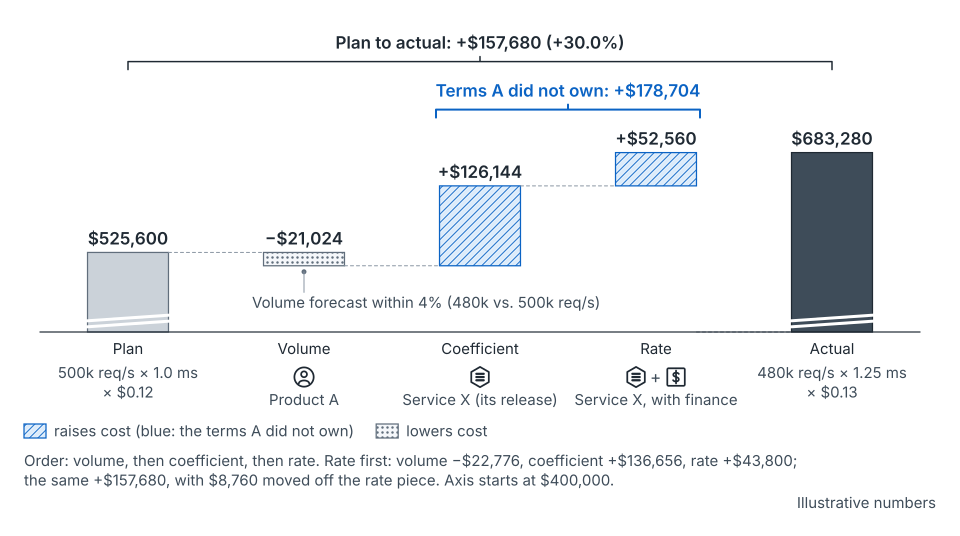

## Why cases

A framework tells you what to look for. A case shows what it looked like when it went wrong, and what each piece cost. Every case told from experience uses one fixed format: Setting, The plan, What happened, Why, and Lessons learned. The format keeps cases comparable and keeps the lesson apart from the story.

## Case 1: the launch that needed memory

*All numbers are illustrative. The case is the seed paper's own worked example (Section 7 and Appendix A).*

### Setting

Service X is a shared document store. Product A is its largest caller. X bills only for CPU, at $0.12 per busy core-hour. Installed cores are twice busy ones, for failure domains and queueing headroom.

Two kinds of machine matter. High-memory machines take two quarters to arrive. Standard machines come from a stocked pool in weeks.

### The plan

A declared next year's peak at 500,000 requests per second, up from 400,000. That was 40,000 of organic growth and 60,000 from a launch at the start of the second quarter.

The launch firmed up in stages. It was an intent of 40,000 to 100,000 at the annual cycle. It was dated at month −6, with a base of 60,000 and a high of 90,000. It was configured at −3, with two regions and the data it would store.

The intake asked only about CPU. So the forum approved four standard machines, 4 units of an invented common unit. The plan priced A's bill at $525,600.

### What happened

- **Month −6** was the high-memory commit point. The launch was only dated, and nobody had asked about stored data.
- **Month −3:** at configuration, the launch's stored data surfaced. Memory, not CPU, drove the need, and the cheapest fit was 4.8 units. The high-memory machines were ordered.
- **Month 0:** launch. Standard machines from the pool ran as a bridge, for their memory, with CPU stranded.
- **Month +3:** the high-memory machines arrived, a quarter late.

The launch landed at 40,000, two-thirds of its base, six weeks late. Organic growth landed on trend. A's total landed at 480,000, within 4%.

The bill landed at $683,280, 30% over plan. A release of X had raised CPU per call, and a power contract had been re-priced.

*From the seed paper, Figure 31.* A forecast within 4% and a bill 30% over. Split by term, each piece gets an owner. Illustrative numbers.

### Why

- **The memory question came after the commit point.** It was asked at −3, three months after the order needed to be placed. That is the two-clock failure (see [commit points](concept-commit-points.md)).
- **The intake asked about one dimension.** Approval priced CPU, but X's memory grows with stored data. Approval was not allocation (see [approval and allocation](concept-approval-and-allocation.md)).
- **Two of the bill's three terms weren't A's.** The coefficient term (+$126,144) belonged to X's release. The rate term (+$52,560) belonged to X with finance. Together they exceed the whole overrun (see [the coefficient](concept-the-coefficient.md)).
- **The miss and the slip had no home.** The size miss showed only as A's smaller bill. The slip showed in no term at all.
- **Two errors offset.** The drifted coefficient used capacity the late launch left idle. That was luck, not a plan working.

### Lessons learned

- Ask for the slow attribute at intent, as a range. The paper's walk moves the stored-data question to −12 and the high-memory commit point to −11 (Section 8.4).
- With that walk, the high-memory machines arrive by −2. No bridge is needed at the base. A bridge is named in advance above 70,000.
- The method's spare has a price. About 1.0 unit held above the base costs about $26,280 a year at the 40,000 landing (Appendix A.5).
- Split every bill miss into volume, coefficient and rate, and give each piece an owner. Decide who *pays* by a rule agreed with finance before the miss.
- Record the launch against its declaration: intent, dated, actual, slip. It moves the next estimate.
- Add a second driver when one dimension isn't priced. X added data stored, from an effective date, not retroactively.

The method doesn't make the launch more accurate. It moves the hard question to the date it was needed, and gives every surprise an owner [argued]. It is untested (see [limits](limits.md)).

## Problem-space cases

Case 1 tells what happened. A problem-space case does something else: it sets out a whole planning problem, as an outside analyst could reconstruct it, and leaves the answers open. It is for practice and discussion, the way a business-school case is.

Problem-space cases follow four rules:

- **Public information only.** Nothing comes from anyone's private experience or an employer's internal data.
- **A fictional company.** The company, its teams, its people and its events are invented. Team names are generic; how teams relate can follow the industry's real shape.
- **Evidence labeled.** Every load-bearing claim says how it would be known: reported, inferred, speculated, or a fact about the wider industry. Speculation carries a falsifier.
- **No quotes from a single company's material.** Paraphrase instead; further reading sits at the end.

Because nothing private goes in, a problem-space case may resemble the industry it draws on. The anonymization checklist below protects accounts of what happened inside an organization; it applies in full to cases like Case 1.

## Case 2: Popcorn Pajamas

*A problem-space case. Popcorn Pajamas is a fictional company. All case studies are collected at [Case studies](/cases/).*

Popcorn Pajamas is a global streaming service with one small planning team, nearly 20,000 caching appliances (Poppers) mostly housed inside other companies' networks, a public cloud in front of everything, and a production estate on its own calendar. Live sport, cloud games and a component shock are remaking its demand and supply at once. The case sets out sixteen decision-shaped problems, twenty causal chains and six stress scenarios for 2027.

- [The case page](case-popcorn-pajamas.md): the situation in two minutes.
- [The full case](case-popcorn-pajamas-full.md).
- [How the practice approaches it](case-popcorn-pajamas-practice.md): each problem mapped to the seed paper, and seven places where the body of knowledge runs out.

## Case 3: Kuantillion Cloud

*A problem-space case with a full answer beside it. Kuantillion Cloud is a fictional company.*

Kuantillion Cloud runs one of the largest computing fleets in the world. It retires machines full of older flash drives while new flash costs three to four times last year's price. Each drive can go to a workload, the spares pool, an upgrade or build, or out of the fleet. The case sets out eight decisions and two sub-decisions, eighteen causal chains and seven stress scenarios for 2027. A companion page then solves it with the practice's body of knowledge, decision by decision, and names where that body of knowledge runs out.

- [The case page](case-kuantillion-cloud.md): the situation in two minutes.
- [The full case](case-kuantillion-cloud-full.md).
- [How the practice solves it](case-kuantillion-cloud-practice.md): the answer, with every judgment that goes past the paper marked.

## How to write a case

Your own cases are how this body of knowledge grows. Use the same five headings:

1. **Setting:** the service, the callers, the supply layers and their lead times. Only what the story needs.
2. **The plan:** what was declared, approved and ordered, and when.
3. **What happened:** a dated timeline, months from launch where you can.
4. **Why:** the causes, each tied to a concept or mechanism where one fits.
5. **Lessons learned:** what you'd do differently, and what it would cost.

Keep sentences short and numbers simple. Label every invented number illustrative. Mark judgment as judgment.

Before you share, anonymize. The checklist is in CONTRIBUTING.md at the root of the repository, under "Writing a case". In short: remove every company, product, team, system and person name. Replace real numbers with illustrative ones that keep the shape. Shift dates and places if they'd identify anyone. If a former colleague could recognize it, blur it more. An editor checks it again before it's added.

## Where this comes from

Seed paper, Section 7 (the worked example), Section 8.4 (the same launch with the method) and Appendix A, especially A.2, A.5 and A.6. The case is invented and all its numbers are illustrative. The case format and the invitation are this guide's choice [argued].
